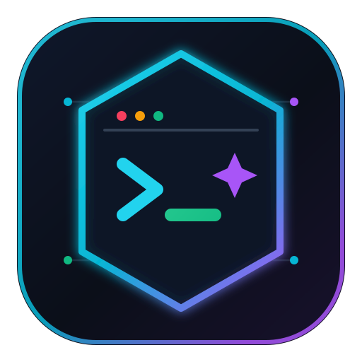
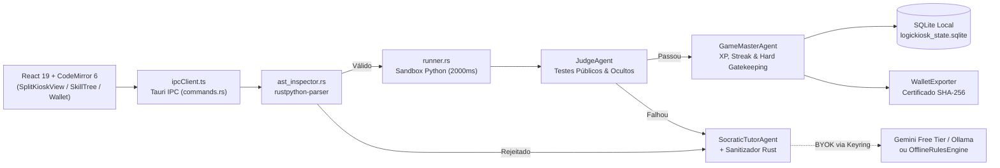

<div align="center">



# LogicKiosk

**Plataforma gamificada e 100% open source para ensino de lógica e algoritmos em Python — com sandbox AST em Rust, tutor socrático anti-cola e certificação SHA-256.**

[](https://github.com/maromo71/sispython/actions/workflows/build-all-platforms.yml)
[](https://github.com/maromo71/sispython/releases/latest)
[](#arquitetura-e-tecnologias)
[](#scripts-disponíveis-e-testes)
[-F59E0B?style=for-the-badge)](./LICENSE)

[Downloads & Distribuições](#-downloads-e-distribuições) · [Rodar na Web](#-como-rodar-na-web) · [Arquitetura](#arquitetura-e-tecnologias) · [Quick Start](#pré-requisitos-e-começando-rápido) · [Reportar Bug](https://github.com/maromo71/sispython/issues)

</div>

---

## Sumário

- [Demonstração Visual](#-demonstração-visual)
- [Principais Funcionalidades](#-principais-funcionalidades)
- [Downloads e Distribuições](#-downloads-e-distribuições)
- [Arquitetura e Tecnologias](#arquitetura-e-tecnologias)
- [Como Rodar na Web](#-como-rodar-na-web)
- [Pré-requisitos e Começando Rápido](#pré-requisitos-e-começando-rápido)
- [Variáveis de Ambiente e IA (BYOK)](#variáveis-de-ambiente-e-ia-byok)
- [Estrutura de Pastas](#estrutura-de-pastas)
- [Scripts Disponíveis e Testes](#scripts-disponíveis-e-testes)
- [Atalhos de Teclado](#atalhos-de-teclado)
- [Como Contribuir, Uso Comercial e Licença](#como-contribuir-uso-comercial-e-licença)

---

## 🎨 Demonstração Visual

O **LogicKiosk** adota um layout de **Quiosque em 3 Painéis (`SplitKioskView`)** com temas `dark-tech` e `light-tech`, acompanhado de ícones vetoriais próprios para cada mecânica pedagógica:

<div align="center">

| Emblema | Módulo | Função na Plataforma |
| :---: | --- | --- |
|  | **Sandbox AST** | Validação sintática via `rustpython-parser` + isolamento por processo |
|  | **Tutor Socrático** | Perguntas guiadas com sanitização anti-código pronto |
|  | **Skill Tree** | Progressão bloqueada por maestria (*Hard Gatekeeping*) |
|  | **Fase Boss** | Avaliação final sem pistas proativas de IA |
|  | **XP & Fragmentos** | Gamificação baseada em tempo, tentativas e eficiência |
|  | **Streak Anti-Cheat** | Sequência diária com detecção de divergência de relógio |
|  | **Carteira Acadêmica** | Exportação e verificação de certificados assinados em SHA-256 |

</div>

```text
+-----------------------------------------------------------------------------------+
| [LogicKiosk]  Módulo 1 [======>---] 60%   |  340 XP | 4d Streak | [Tema] [Chave]  |
+----------------------+-------------------------------+----------------------------+
|  MISSÃO (28%)        |  EDITOR PYTHON (42%)          |  CONSOLE & WATCH (30%)     |
|  ------------------  |  ---------------------------  |  ------------------------  |
|  > Desafio atual     |  1  def somar(a, b):          |  [v] Caso público 1: OK    |
|  > Requisitos AST    |  2      return a + b          |  [v] Caso oculto 2:  OK    |
|  > Casos públicos    |                               |                            |
|                      |                               |  Variable Watch:           |
|  [Pedir Pista Alt+H] |  [Executar Ctrl+Enter]        |  a = 10 | b = 5 -> 15      |
+----------------------+-------------------------------+----------------------------+
```

<!-- Adicione aqui screenshots ou GIFs gravados do LogicKiosk em execução (ex: docs/preview-kiosk.gif) -->

---

## ⚡ Principais Funcionalidades

- **Quiosque de 3 Painéis (`SplitKioskView`):** enunciado em Markdown (`MissionPanel`), editor **CodeMirror 6** com realce de linha de foco (`CodeEditorPane`), console de vereditos e inspetor de variáveis (`ExecutionConsole`, `VariableWatch`).
- **Sandbox Python em Duas Camadas (`src-tauri/src/sandbox/`):**
  - **AST Inspector:** analisa a árvore sintática com `rustpython-parser` / `rustpython-ast`, bloqueando imports/chamadas perigosas e validando estruturas exigidas pela fase.
  - **Runner Isolado:** executa o código em subprocesso com timeout padrão de `2000ms`, limite de `64 MB` de memória e teto de `10000` caracteres de saída.
- **Motor Multiagente (`src-tauri/src/agents/`):**
  - `JudgeAgent` — valida casos de teste públicos e casos de borda ocultos.
  - `SocraticTutorAgent` — gera perguntas orientadoras e aplica **sanitização determinística em Rust** para impedir entrega de código pronto; fases `BOSS` bloqueiam pedidos proativos de pista.
  - `OfflineRulesEngine` — garante feedback pedagógico local mesmo 100% offline.
  - `GameMasterAgent` — calcula XP, insígnias, *Hard Gatekeeping* e *streak* protegido contra manipulação de relógio.
- **Carteira Acadêmica (`WalletExporter`):** exporta e verifica certificados JSON assinados criptograficamente com **SHA-256**.
- **BYOK Segura via Keyring do SO:** chaves de IA (Google Gemini Free Tier / BYOK) são armazenadas exclusivamente no cofre nativo do sistema operacional (`keyring`), nunca em SQLite ou `localStorage`.

---

## 📦 Downloads e Distribuições

Todos os pacotes oficiais são compilados automaticamente pelo workflow [`build-all-platforms.yml`](./.github/workflows/build-all-platforms.yml):

- **Releases Oficiais (Instaladores por tag `v*`):** https://github.com/maromo71/sispython/releases
- **Última Versão Publicada:** https://github.com/maromo71/sispython/releases/latest
- **Builds Contínuos (Artefatos de cada commit no GitHub Actions):** https://github.com/maromo71/sispython/actions/workflows/build-all-platforms.yml

| Plataforma | Runner CI | Artefatos Gerados | Onde Baixar |
| --- | --- | --- | --- |
| **Windows (`x86_64`)** | `windows-latest` | Instaladores `.msi` e `.exe` (NSIS) | [Releases](https://github.com/maromo71/sispython/releases) · `logickiosk-windows` no [Actions](https://github.com/maromo71/sispython/actions/workflows/build-all-platforms.yml) |
| **macOS (Universal)** | `macos-latest` | `.dmg` Universal (Apple Silicon + Intel) e `.app.tar.gz` | [Releases](https://github.com/maromo71/sispython/releases) · `logickiosk-macos` no [Actions](https://github.com/maromo71/sispython/actions/workflows/build-all-platforms.yml) |
| **Android / Android Studio** | `ubuntu-latest` | `.apk`, `.aab` e projeto `LogicKiosk-android-studio-project.tar.gz` | [Releases](https://github.com/maromo71/sispython/releases) · `logickiosk-android` no [Actions](https://github.com/maromo71/sispython/actions/workflows/build-all-platforms.yml) |
| **iOS / Xcode** | `macos-latest` | Projeto Xcode `.tar.gz` + `.ipa` (com assinatura) ou `.xcarchive` não assinado | [Releases](https://github.com/maromo71/sispython/releases) · `logickiosk-ios` no [Actions](https://github.com/maromo71/sispython/actions/workflows/build-all-platforms.yml) |
| **Web (SPA Vite)** | Qualquer host estático | Bundle estático em `dist/` | Gerado localmente via `npm run build` |

> Para detalhes técnicos sobre assinatura iOS opcional e disparo de builds no CI, consulte [BUILD_CI.md](./BUILD_CI.md).

---

## Arquitetura e Tecnologias

| Camada | Stack Principal |
| --- | --- |
| **Front-end Web / UI** | React 19, TypeScript 5.7, Vite 5, Tailwind CSS v4, Zustand 5, Framer Motion, CodeMirror 6, Lucide Icons + SVGs próprios |
| **Core Nativo (Desktop/Mobile)** | Tauri v2 (`2.1.x`), Rust (`edition 2021`), Tokio |
| **AST & Sandbox Python** | `rustpython-parser` / `rustpython-ast` (`0.4.0`), subprocesso isolado com limites de tempo, RAM e stdout |
| **Persistência & Segurança** | SQLite local-first (`sqlx 0.8` + migrations), OS Keyring (`keyring 3.6`), `sha2` / `hex` |
| **IA & Fallback Offline** | Google AI Studio (Gemini Free Tier) + Ollama local opcional + `OfflineRulesEngine` em Rust |
| **QA & Testes** | Vitest + Testing Library + jsdom (Front-end), `cargo test` + `wiremock` (Rust) |



---

## 🌐 Como Rodar na Web

O front-end do **LogicKiosk** é compilado com **Vite** (porta padrão `1420` definida em [`vite.config.ts`](./vite.config.ts)).

### 1. Servidor de desenvolvimento Web

```bash
git clone https://github.com/maromo71/sispython.git
cd sispython
npm install
npm run dev
```

Abra no navegador em **`http://localhost:1420`**.

### 2. Build estático para deploy Web (`dist/`)

Para publicar em **GitHub Pages**, **Vercel**, **Netlify**, **Cloudflare Pages** ou **Nginx**:

```bash
npm install
npm run build
npm run preview
```

Os arquivos estáticos finais serão gerados em `./dist/`.

> **Modo Web Puro vs. Runtime Nativo (Tauri):**
> Na arquitetura atual, o parser AST, o executor Python, o SQLite local, o `keyring` do SO e a assinatura SHA-256 executam no núcleo Rust ([`src-tauri/`](./src-tauri)). Ao abrir apenas o servidor Vite no navegador (`isTauriRuntime() === false` em [`src/services/ipcClient.ts`](./src/services/ipcClient.ts)), a interface React é exibida sem erros, mas sem o backend IPC para executar código Python ou persistir progresso.
> Para rodar **todas as funcionalidades ponta a ponta**, use `npm run tauri dev` ou baixe os instaladores nativos. Caso deseje tornar a versão Web 100% autônoma no navegador (ex.: integrando **Pyodide/WASM** ou API HTTP), basta adaptar [`src/services/ipcClient.ts`](./src/services/ipcClient.ts).

---

## Pré-requisitos e Começando Rápido

### Pré-requisitos

- **Node.js** `22+` e **npm**
- **Rust** (`rustup` / `cargo` estável)
- **Python 3** instalado no sistema (utilizado pela sandbox isolada)
- **Dependências nativas do Tauri v2:**
  - **Windows:** Microsoft C++ Build Tools + WebView2 (nativo no Windows 10/11)
  - **macOS:** Xcode Command Line Tools (`xcode-select --install`)
  - **Linux (Ubuntu/Debian):** `libwebkit2gtk-4.1-dev build-essential curl wget file libxdo-dev libssl-dev libayatana-appindicator3-dev librsvg2-dev libdbus-1-dev pkg-config`

### Passo a passo (Aplicação Completa Tauri + Rust + SQLite)

1. **Clone o repositório:**
   ```bash
   git clone https://github.com/maromo71/sispython.git
   cd sispython
   ```
2. **Instale as dependências do front-end:**
   ```bash
   npm install
   ```
3. **Configure as variáveis de ambiente (opcional):**
   ```bash
   cp .env.example .env
   ```
   *(No Windows PowerShell: `Copy-Item .env.example .env`)*
4. **Inicie o app completo em modo desenvolvimento** *(as migrations SQLite em `src-tauri/migrations/` são aplicadas automaticamente na inicialização)*:
   ```bash
   npm run tauri dev
   ```
5. **Gere o instalador de produção para seu sistema:**
   ```bash
   npm run tauri build
   ```

---

## Variáveis de Ambiente e IA (BYOK)

Consulte o arquivo modelo [`.env.example`](./.env.example). Chaves pessoais inseridas na interface ficam protegidas no **Keyring do Sistema Operacional**.

| Variável | Valor Padrão (`.env.example`) | Finalidade |
| --- | --- | --- |
| `TAURI_ENV_DEBUG` | `false` | Ativa logs extras de diagnóstico no backend Tauri |
| `LOGICKIOSK_DB_FILENAME` | `logickiosk_state.sqlite` | Nome do arquivo SQLite local de progresso |
| `GEMINI_API_BASE_URL` | `https://generativelanguage.googleapis.com/v1beta/models` | Endpoint base do provedor Google AI Studio |
| `GEMINI_PRIMARY_FREE_MODEL` | `gemini-3.8-flash` | Modelo primário gratuito para pistas socráticas |
| `GEMINI_FALLBACK_FREE_MODEL` | `gemini-3.5-flash-lite` | Modelo de failover automático em caso de `429`/erro |
| `GEMINI_OPEN_FREE_MODEL` | `gemma-4-26b-a4b-it` | Terceiro modelo aberto na cascata de fallback |
| `GEMINI_REQUEST_TIMEOUT_MS` | `8000` | Timeout das requisições à API de IA (ms) |
| `LOCAL_LLM_ENABLED` | `false` | Habilita LLM local via Ollama |
| `LOCAL_LLM_ENDPOINT` | `http://127.0.0.1:11434/api/generate` | URL da instância local do Ollama |
| `LOCAL_LLM_MODEL` | `qwen2.5-coder:3b` | Modelo local utilizado no Ollama |
| `SANDBOX_MAX_EXECUTION_TIME_MS` | `2000` | Tempo máximo de execução de código na sandbox (ms) |
| `SANDBOX_MAX_MEMORY_MB` | `64` | Limite de memória por execução na sandbox (MB) |
| `SANDBOX_MAX_OUTPUT_CHARS` | `10000` | Limite máximo de caracteres capturados no stdout |

---

## Estrutura de Pastas

```text
sispython/
├── .github/workflows/
│   └── build-all-platforms.yml   # Pipeline CI/CD: QA + Windows, macOS, Android e iOS
├── public/icons/                 # 8 ícones SVG personalizados da aplicação
├── src/                          # Front-end React 19 + TypeScript + Tailwind CSS v4
│   ├── components/
│   │   ├── academic/             # WalletExporter (certificados SHA-256)
│   │   ├── icons/                # Componentes React SVG (LogicKioskIcons.tsx)
│   │   ├── kiosk/                # MissionPanel, CodeEditorPane, ExecutionConsole, VariableWatch
│   │   ├── layout/               # TopHudBar, SplitKioskView
│   │   ├── map/                  # SkillTreeGraph (Hard Gatekeeping + Boss)
│   │   └── settings/             # ApiKeyModal (BYOK segura no Keyring)
│   ├── services/ipcClient.ts     # Ponte IPC Tauri + detecção isTauriRuntime()
│   ├── store/                    # Zustand stores (tema, quiosque, progressão)
│   ├── styles/themes.css         # Temas dark-tech e light-tech
│   └── types/ipc.ts              # Contratos TypeScript espelhados de commands.rs
├── src-tauri/                    # Núcleo nativo Tauri v2 + Rust
│   ├── migrations/               # 0001_initial_schema.sql (schema + Módulo 1)
│   ├── src/agents/               # judge, socratic, offline_rules, game_master
│   ├── src/db/                   # Repositório SQLite (sqlx)
│   ├── src/ipc/commands.rs       # Contrato IPC simétrico com src/types/ipc.ts
│   ├── src/sandbox/              # Parser AST (rustpython-parser) + runner isolado
│   ├── tests/                    # Testes de integração (SQLite, Sandbox, Wiremock)
│   ├── Cargo.toml
│   └── tauri.conf.json
├── .env.example
├── AGENTS.md                     # Regras de arquitetura e fronteira IPC
├── BUILD_CI.md                   # Guia de builds multiplataforma no Actions
├── LICENSE                       # Licença MIT
└── SPEC.md                       # Especificação técnica completa
```

---

## Scripts Disponíveis e Testes

| Comando | Descrição |
| --- | --- |
| `npm run dev` | Sobe o front-end Web Vite na porta `1420` |
| `npm run build` | Executa `tsc -b` + `vite build` e gera o bundle Web em `dist/` |
| `npm run preview` | Serve localmente o build de produção `dist/` |
| `npm test` | Executa a suíte de testes Vitest (`src/test/kiosk.test.tsx`) |
| `npm run test:watch` | Executa Vitest em modo observação |
| `npm run tauri dev` | Inicia o aplicativo desktop completo (Front-end + Rust/SQLite) |
| `npm run tauri build` | Gera o pacote instalável nativo para o sistema atual |
| `cargo test --manifest-path src-tauri/Cargo.toml` | Executa todos os testes unitários e de integração em Rust |

> **Observação de contrato:** ao modificar estruturas trocadas entre Rust e React, mantenha a simetria estrita entre [`src-tauri/src/ipc/commands.rs`](./src-tauri/src/ipc/commands.rs) e [`src/types/ipc.ts`](./src/types/ipc.ts) conforme definido em [`AGENTS.md`](./AGENTS.md).

---

## Atalhos de Teclado

| Atalho | Ação |
| --- | --- |
| `Ctrl + Enter` | Executar e submeter código na sandbox |
| `Alt + H` | Solicitar pista socrática *(bloqueado em fases `BOSS`)* |
| `Alt + T` | Alternar tema (`dark-tech` / `light-tech`) |
| `Ctrl + Shift + Enter` | Avançar para a próxima fase desbloqueada |

---

## Como Contribuir, Uso Comercial e Licença

### Como Contribuir

1. Faça um **fork** do repositório: https://github.com/maromo71/sispython
2. Crie uma branch para sua alteração:
   ```bash
   git checkout -b feat/minha-melhoria
   ```
3. Valide os testes antes de abrir seu Pull Request:
   ```bash
   npm test
   npm run build
   cargo test --manifest-path src-tauri/Cargo.toml
   ```
4. Envie seu **Pull Request** descrevendo claramente a mudança.

### Open Source Completo & Liberdade Comercial (Licença MIT)

Este projeto é distribuído sob a **[Licença MIT](./LICENSE)** — uma das licenças open source mais permissivas que existem:

- ✅ **Livre para usar:** em estudos, escolas, universidades, empresas ou projetos pessoais.
- ✅ **Livre para mexer e adicionar:** adapte o currículo, adicione novas linguagens, crie suporte a WebAssembly/Pyodide no navegador, integre novos provedores de IA ou LMS.
- ✅ **Livre para distribuir e lucrar:** você pode vender cópias, oferecer como produto comercial/SaaS, empacotar em cursos pagos ou soluções corporativas sem taxas ou royalties, mantendo apenas o aviso de copyright e o texto da [Licença MIT](./LICENSE).
