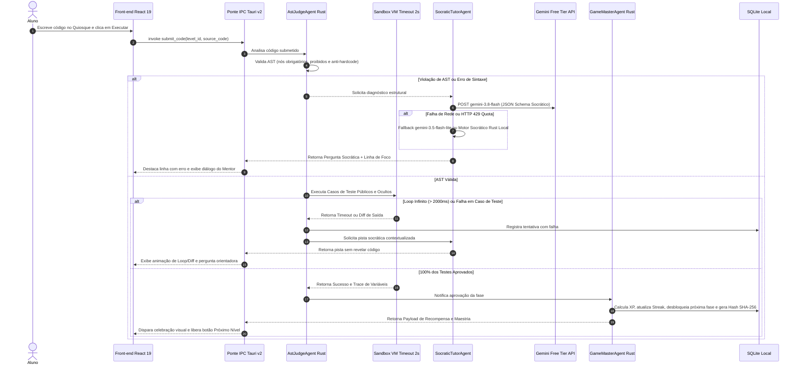

A Especificação de Engenharia de Software (**SPEC.md**) a seguir consolida todas as definições da Fase 1 em um documento técnico estruturado sob a metodologia **Spec-Driven Development (SDD)**. O documento está pronto para ser salvo na raiz do projeto (como `SPEC.md` ou `AGENTS.md`) e consumido diretamente pelo orquestrador de subagentes do **Google Antigravity IDE** ou pelo **GitHub Copilot**.

---

# SPEC: LogicKiosk — Plataforma Gamificada de Ensino de Lógica e Algoritmos

## 1. Visão Geral e Arquitetura Técnica

### 1.1 Resumo do Produto

O **LogicKiosk** é um aplicativo nativo multiplataforma (Windows, macOS, Linux, Android e iOS) construído sobre **Tauri v2** e **Rust**, projetado para o ensino progressivo de lógica de programação e algoritmos. O estudante resolve problemas reais em **Quiosques de Código Isolados (Sandboxes)**, avançando apenas após comprovar maestria técnica (validação de casos de teste + inspeção da Árvore Sintática Abstrata — AST). O sistema é governado por três agentes inteligentes de regras de negócio que atuam como juiz semântico, tutor socrático (utilizando modelos gratuitos da API Gemini com fallback determinístico 100% offline em Rust) e mestre de gamificação. Ao concluir módulos, o aluno pode exportar uma **Carteira de Progresso Assinada Criptograficamente (SHA-256)** para comprovação acadêmica.

### 1.2 Stack Tecnológica

* **Core & Runtime Nativo:** Tauri v2 (Rust `1.82+`, Runtime Assíncrono `tokio`, serialização IPC `serde` / `serde_json`).
* **Front-end (WebView WRY):** React 19, TypeScript `5.6+`, Vite 6, Tailwind CSS v4, Zustand (gerenciamento de estado global), Lucide React (iconografia), Framer Motion (microinterações de gamificação).
* **Editor e Quiosque de Código:** CodeMirror 6 (configurado com suporte a Python 3, realce de linha ativa, bloqueio de colagem externa opcional em desafios *Boss* e *gutter* de inspeção de variáveis).
* **Motor de Execução e Inspeção AST (Sandbox Segura):**
* **Análise Estática e AST (Back-end Rust):** Crate `rustpython-parser` para converter o código Python do aluno em AST no Rust em tempo menor que 5 ms, validando restrições estruturais antes da execução.
* **Execução Isolada (Sandbox):** `RustPython VM` embarcada em thread isolada no Rust com limite de *ticks* de CPU e memória (ou `Pyodide WASM` em Web Worker isolado com interrupção via `SharedArrayBuffer` em tempo menor que 2000 ms).


* **Banco de Dados Local-First:** SQLite 3 embarcado via `sqlx` (com migrações embutidas no binário Rust) e armazenamento seguro de chaves via `keyring` nativo do sistema operacional.
* **Inteligência Artificial Gratuita (Híbrida Online/Offline):**
* **Camada Online Gratuita (Google AI Studio Free Tier):** Consumo via cliente HTTP `reqwest` em Rust apontando para os modelos gratuitos da API Gemini:
* Modelo Primário: `gemini-3.8-flash` (cota gratuita no Google AI Studio, com suporte gratuito a *Context Caching* para manter a ementa pedagógica em cache).
* Modelo de Fallback Rápido (Alta Vazão): `gemini-3.5-flash-lite` ou `gemma-4-26b-a4b-it` (ambos gratuitos sem exigência de cartão no nível Free Tier).


* **Camada Local Opcional:** Suporte a endpoint compatível com `localhost:11434` (Ollama rodando `gemma4` ou `qwen2.5-coder`).
* **Camada Determinística 100% Offline (Rust Native Socratic Engine):** Caso não haja internet nem LLM local, o Agente Socrático utiliza um motor de casamento de padrões de AST e mapa de erros em Rust para fornecer perguntas orientadoras pré-estruturadas por fase.


---

### 1.3 Arquitetura de Agentes de Regras de Negócio e Guia para Google Antigravity / Copiloto

Para que o **Google Antigravity IDE** (que opera com subagentes paralelos coordenados pelo *Orchestrator* sobre o `gemini-3.8-flash` / `gemini-4-hydrogen`) ou o **Copilot** implementem os agentes sem desvios, a lógica de negócio no back-end Rust (`src-tauri/src/agents/`) é dividida em três módulos estritos:

#### A. `AstJudgeAgent` (Juiz Determinístico em Rust)

* **Responsabilidade:** Analisar o código submetido em duas etapas obrigatórias antes de aprovar a fase:
1. **Validação Estrutural (AST):** Verifica nós obrigatórios (`must_contain_nodes`, ex.: `For`, `While`, `FunctionDef`) e nós proibidos (`forbidden_nodes`, ex.: uso de `eval`, `exec`, `import os`, ou múltiplos `If` encadeados quando o desafio exige laço de repetição). Detecta *hardcoding* verificando se os literais de saída dos casos de teste estão escritos diretamente no `print` ou `return`.
2. **Validação Funcional (Test Runner):** Executa o código contra casos de teste públicos (visíveis ao aluno) e casos de teste ocultos de borda (*hidden edge cases*).


#### B. `SocraticTutorAgent` (Mentor Pedagógico — Free Tier Gemini + Fallback Rust)

* **Responsabilidade:** Atuar quando o `AstJudgeAgent` detecta falha ou quando o aluno aciona o botão "Pedir Pista Socrática".
* **Regra Inviolável de Negócio (Guardrail):** O agente **nunca** retorna código pronto que resolva o exercício. A resposta da API Gemini é forçada via `response_schema` (Structured Outputs JSON) e validada por um filtro regex em Rust que remove blocos de código maiores que 1 linha.
* **Estratégia de Custo Zero para o Programador/Usuário:**
1. No **Google AI Studio**, gere uma chave gratuita e configure o cliente Rust para usar o endpoint `[https://generativelanguage.googleapis.com/v1beta/models/gemini-3.8-flash:generateContent](https://generativelanguage.googleapis.com/v1beta/models/gemini-3.8-flash:generateContent)`.
2. Implemente um **Rate-Limit Cascader** em Rust: se o `gemini-3.8-flash` retornar `HTTP 429 (Too Many Requests)` na cota gratuita, a requisição faz *retry* imediato e transparente para `gemini-3.5-flash-lite` e, em seguida, para `gemma-4-26b-a4b-it`. Se o dispositivo estiver offline, aciona o `OfflineSocraticEngine` em Rust.
3. **JSON Schema Obrigatório de Resposta do Agente Socrático:**


```json
{
  "diagnostic_category": "SYNTAX_ERROR | LOGIC_MISMATCH | AST_VIOLATION | INFINITE_LOOP",
  "friendly_explanation": "Explicação curta e acolhedora do que aconteceu na execução sem dar a resposta.",
  "socratic_question": "Pergunta instigadora que leva o aluno a olhar para a linha ou variável específica.",
  "focus_line": 4,
  "conceptual_reminder": "Lembrete de 1 frase sobre o conceito da fase (ex: condição de parada do while)."
}

```

#### C. `MasteryGameMasterAgent` (Diretor de Progressão e Gamificação)

* **Responsabilidade:** Calcular recompensas, gerenciar *Hard Gatekeeping* (bloqueio de fases) e assinar a carteira de progresso.
* **Fórmula Determinística de XP:**

$$\text{XP}_{\text{ganho}} = \lfloor \text{XP}_{\text{base}} \times M_{\text{tentativa}} \times M_{\text{pistas}} \times M_{\text{streak}} \rfloor$$

* Onde:
* $M_{\text{tentativa}} = 1.25$ se aprovado na 1ª tentativa; $1.0$ até a 3ª tentativa; $0.8$ após 4+ tentativas.
* $M_{\text{pistas}} = 1.0$ se usou 0 pistas; $0.85$ para 1 pista; $0.70$ para 2+ pistas (em fases *Boss*, pistas são bloqueadas).
* $M_{\text{streak}} = \min(1.5, 1.0 + (\text{dias\_consecutivos} \times 0.05))$.


* **Gatilho de Revisão Adaptativa:** Se o aluno aprovar uma fase após $\ge 5$ erros lógicos ou com tempo $> 3\times$ o tempo médio esperado, o agente agenda automaticamente um "Desafio Relâmpago de Fixação" antes da fase *Boss* do módulo.

---

### 1.4 Estrutura de Diretórios Recomendada

```text
logickiosk/
├── .antigravity/
│   └── config.yaml                 # Regras de escopo para subagentes do Google Antigravity IDE
├── AGENTS.md                       # Instruções mestras para agentes de IA (Antigravity / Copilot)
├── .env.example                    # Template de variáveis de ambiente
├── package.json
├── vite.config.ts
├── tsconfig.json
├── src/                            # Front-end (React 19 + TS + Tailwind v4)
│   ├── main.tsx
│   ├── App.tsx
│   ├── styles/
│   │   └── themes.css              # Design Tokens: Dark Tech & Light Tech Gamificada
│   ├── store/
│   │   ├── useThemeStore.ts        # Alternância Dark/Light com persistência
│   │   ├── useKioskStore.ts        # Estado do editor, console, testes e variáveis
│   │   └── useProgressionStore.ts  # Estado de XP, nível, streaks, fases desbloqueadas
│   ├── components/
│   │   ├── layout/
│   │   │   ├── TopHudBar.tsx       # Barra superior com XP, Streak, Nível e Toggle de Tema
│   │   │   └── SplitKioskView.tsx  # Layout de 3 painéis redimensionáveis
│   │   ├── kiosk/
│   │   │   ├── MissionPanel.tsx    # Enunciado, requisitos de AST e chat do Agente Socrático
│   │   │   ├── CodeEditorPane.tsx  # CodeMirror 6 + Gutter de execução
│   │   │   ├── ExecutionConsole.tsx# Resultados dos testes públicos/ocultos
│   │   │   └── VariableWatch.tsx   # Inspetor visual de variáveis passo a passo
│   │   ├── map/
│   │   │   └── SkillTreeGraph.tsx  # Mapa visual de níveis e Boss Levels
│   │   └── academic/
│   │       └── WalletExporter.tsx  # Exportação de relatório assinado SHA-256
│   └── types/
│       └── ipc.ts                  # Contratos TypeScript espelhados das structs Rust
└── src-tauri/                      # Back-end Nativo (Rust + Tauri v2)
    ├── Cargo.toml
    ├── tauri.conf.json
    ├── migrations/
    │   └── 0001_initial_schema.sql # Schema SQLite completo + Seed de fases iniciais
    └── src/
        ├── main.rs
        ├── lib.rs
        ├── ipc/
        │   └── commands.rs         # Comandos #[tauri::command] expostos ao Front-end
        ├── sandbox/
        │   ├── runner.rs           # Execução isolada com Timeout < 2000ms e captura de stdout/trace
        │   └── ast_inspector.rs    # Parser rustpython-parser para validação estrutural
        ├── agents/
        │   ├── judge.rs            # AstJudgeAgent: orquestra AST + Casos de Teste
        │   ├── socratic.rs         # SocraticTutorAgent: Cascader Gemini Free Tier + Fallback Local
        │   ├── offline_rules.rs    # Dicionário determinístico de dicas socráticas offline
        │   └── game_master.rs      # MasteryGameMasterAgent: XP, Streaks, Gatekeeping e SHA-256
        └── db/
            └── repository.rs       # Camada de persistência SQLite assíncrona

```

### 1.5 Variáveis de Ambiente (`.env.example`)

```ini
# Configuração da Plataforma e Banco Local
TAURI_ENV_DEBUG=false
LOGICKIOSK_DB_FILENAME=logickiosk_state.sqlite

# Configuração de IA Gratuita (Google AI Studio Free Tier)
# O usuário também pode configurar sua própria chave (BYOK) direto na interface do app (salva no Keychain do SO)
GEMINI_API_BASE_URL=https://generativelanguage.googleapis.com/v1beta/models
GEMINI_PRIMARY_FREE_MODEL=gemini-3.8-flash
GEMINI_FALLBACK_FREE_MODEL=gemini-3.5-flash-lite
GEMINI_OPEN_FREE_MODEL=gemma-4-26b-a4b-it
GEMINI_REQUEST_TIMEOUT_MS=8000

# Fallback LLM Local Opcional (Ollama)
LOCAL_LLM_ENABLED=false
LOCAL_LLM_ENDPOINT=http://127.0.0.1:11434/api/generate
LOCAL_LLM_MODEL=qwen2.5-coder:3b

# Limites do Sandbox de Execução
SANDBOX_MAX_EXECUTION_TIME_MS=2000
SANDBOX_MAX_MEMORY_MB=64
SANDBOX_MAX_OUTPUT_CHARS=10000

```

---

## 2. Diagramação com Mermaid.js

### 2.1 Fluxo de Submissão, Julgamento AST e Tutoria Socrática



### 2.2 Modelo de Dados Entidade-Relacionamento (`erDiagram`)

```mermaid
erDiagram
    PROFILES ||--o{ USER_PROGRESS : possui
    PROFILES ||--o{ SUBMISSIONS : realiza
    PROFILES ||--o{ USER_BADGES : conquista
    PROFILES ||--o{ SIGNED_CERTIFICATES : exporta
    MODULES ||--|{ LEVELS : contem
    LEVELS ||--|{ TEST_CASES : valida_com
    LEVELS ||--o{ USER_PROGRESS : rastreia
    LEVELS ||--o{ SUBMISSIONS : recebe
    SUBMISSIONS ||--o{ SOCRATIC_INTERACTIONS : gera
    BADGES ||--o{ USER_BADGES : referencia

    PROFILES {
        string id PK
        string display_name
        string theme_preference "dark_tech | light_tech"
        int total_xp
        int current_level_rank
        int logic_fragments
        int current_streak_days
        string last_activity_date
        string created_at
    }

    MODULES {
        string id PK
        int order_index
        string title
        string description
        int required_xp_to_unlock
    }

    LEVELS {
        string id PK
        string module_id FK
        int order_index
        string title
        string level_type "STANDARD | FIXATION | BOSS"
        string problem_statement_md
        string starter_code
        string ast_must_contain_json "Ex: For, While, FunctionDef"
        string ast_forbidden_json "Ex: Eval, Import, HardcodedReturn"
        int base_xp_reward
        int expected_time_seconds
    }

    TEST_CASES {
        string id PK
        string level_id FK
        string input_data_json
        string expected_output_json
        boolean is_hidden_edge_case
        string failure_concept_tag
    }

    USER_PROGRESS {
        string id PK
        string profile_id FK
        string level_id FK
        string status "LOCKED | UNLOCKED | COMPLETED_MASTERY"
        int attempts_count
        int hints_used_count
        int best_execution_time_ms
        int earned_xp
        string completed_at
    }

    SUBMISSIONS {
        string id PK
        string profile_id FK
        string level_id FK
        string submitted_code
        string verdict "PASSED | AST_REJECTED | TEST_FAILED | TIMEOUT_LOOP | SYNTAX_ERROR"
        int execution_time_ms
        string variable_trace_json
        string created_at
    }

    SOCRATIC_INTERACTIONS {
        string id PK
        string submission_id FK
        string provider_used "GEMINI_3_8_FLASH | GEMINI_3_5_LITE | LOCAL_RUST_ENGINE"
        string diagnostic_category
        string socratic_question
        int focus_line
        string created_at
    }

    BADGES {
        string id PK
        string code
        string title
        string description
        string icon_name
        string rule_condition_json
    }

    USER_BADGES {
        string id PK
        string profile_id FK
        string badge_id FK
        string unlocked_at
    }

    SIGNED_CERTIFICATES {
        string id PK
        string profile_id FK
        stringmodule_id FK
        string payload_json
        string sha256_signature
        string issued_at
    }

```

---

## 3. Diretrizes de IHC e UX

### 3.1 Princípios de Usabilidade (Heurísticas de Nielsen no Quiosque)

1. **Visibilidade do Status do Sistema:** O cabeçalho (HUD) mostra permanentemente o nível de XP, ofensiva (*streak*), status de conexão da IA (`Online: Gemini Free` ou `Offline: Motor Nativo Rust`) e o progresso percentual no módulo atual.
2. **Correspondência entre o Sistema e o Mundo Real (Tradução Pedagógica):** Erros brutos do interpretador (`IndexError: list index out of range`) nunca são exibidos isoladamente; o painel exibe o erro original recolhido para aprendizado técnico e, em destaque principal, a explicação didática em português gerada pelo Agente Socrático.
3. **Prevenção de Erros e Restrições Visuais:** Antes mesmo de clicar em "Executar", um *linter* leve baseado nos requisitos da fase sinaliza como *checklist* interativo se a estrutura exigida (ex.: `Usar laço while`) já está presente no editor.
4. **Reconhecimento em vez de Memorização:** O Painel Direito conta com um **Inspetor Visual de Variáveis (*Step Watch*)** que mostra em formato de tabela animada como o valor de cada variável mudou a cada iteração do laço na última execução.

### 3.2 Estados de Interface (UI States)

* **Loading State (Execução e IA):** Ao clicar em `Executar (Ctrl+Enter)`, o botão exibe um *spinner* vetorial de 16x16px e o console mostra *skeletons* pulsantes por até 2000 ms. Enquanto o Agente Socrático formula uma pergunta, aparece o indicador `"Mentor analisando sua lógica..."` com animação de três pontos.
* **Empty State (Primeiro Acesso e Console Limpo):** No primeiro acesso, o aluno é recebido por um desafio interativo de 30 segundos ("Calibrando seu Terminal") que ensina como editar e executar código. Quando o console ainda não foi executado na fase, exibe a ilustração vetorial minimalista de um circuito aberto com a instrução: `"Pressione Ctrl+Enter ou clique em Testar Código para alimentar o circuito lógico."`
* **Error & Loop Timeout State:**
* **Loop Infinito (> 2000 ms):** A execução é abortada pelo Rust; a borda do console pulsa em âmbar (`--color-warning`), exibindo um contador visual de iterações travadas e uma pergunta socrática sobre a condição de parada do laço.
* **Falha em Caso de Teste Oculto:** Mostra o tipo de caso de borda violado (ex.: `"Falha ao testar com números negativos ou zero"`) sem revelar o valor exato de saída para evitar *hardcoding*.


* **Success & Mastery State:** Ao aprovar 100% dos testes e regras de AST, o painel emite feedback sonoro sutil (desativável), anima a transferência de partículas de XP para a barra superior, exibe o resumo de eficiência (tempo de execução, tentativas) e habilita o botão primário `Avançar para Fase Seguinte (Ctrl+Shift+Enter)` com área mínima de clique de `48x48px`.

### 3.3 Design Tokens e Sistema Dual de Temas (Dark Tech & Light Tech Gamificada)

A interface suporta comutação instantânea via atributo `data-theme="dark-tech" | "light-tech"` na tag `<html>`, garantindo contraste mínimo **WCAG AA (4.5:1 para texto normal, 7:1 para código)**.

| Token Semântico CSS | Tema 1: Dark Tech Gamificada (Padrão) | Tema 2: Light Tech Gamificada (Diurno/Lab) | Aplicação na Interface |
| --- | --- | --- | --- |
| `--bg-canvas` | `#0B0F19` (Obsidiana Profundo) | `#F8FAFC` (Alabastro Técnico) | Fundo principal da janela |
| `--bg-surface-panel` | `#111827` (Ardósia Escuro) | `#FFFFFF` (Branco Puro) | Fundo dos 3 painéis do quiosque |
| `--bg-surface-elevated` | `#1E293B` (Grafite Azulado) | `#F1F5F9` (Cinza Gelo) | Cards de casos de teste e chat socrático |
| `--border-subtle` | `#334155` | `#CBD5E1` | Divisores de painéis e bordas de cards |
| `--text-primary` | `#F8FAFC` | `#0F172A` | Títulos, enunciados e código principal |
| `--text-secondary` | `#94A3B8` | `#475569` | Rótulos secundários e dicas |
| `--accent-primary` | `#06B6D4` (Ciano Neon) | `#0284C7` (Azul Engenharia) | Ações primárias, foco e cursores |
| `--accent-gamification` | `#A855F7` (Roxo Quântico) | `#7C3AED` (Violeta Real) | XP, Insígnias, *Boss Levels* e Fragmentos |
| `--status-success` | `#10B981` (Verde Esmeralda) | `#059669` (Verde Floresta) | Testes aprovados e desbloqueio de fase |
| `--status-warning` | `#F59E0B` (Âmbar Solar) | `#D97706` (Ocre Alerta) | *Streaks*, pistas socráticas e *Timeouts* |
| `--status-danger` | `#F43F5E` (Rosa Carmim) | `#E11D48` (Vermelho Rubi) | Erros de sintaxe, falhas de AST e testes |

* **Tipografia:**
* Interface e Enunciados: `Inter` ou `Plus Jakarta Sans` (pesos 400, 600, 700).
* Código, Console e Inspetor de Variáveis: `JetBrains Mono` ou `Fira Code` com ligaduras tipográficas opcionais (`font-variant-ligatures: contextual`).


* **Layout Split-View Responsivo:**
* **Desktop ($\ge 1024\text{px}$):** 3 colunas redimensionáveis (Esquerda `28%`: Enunciado + Agente Socrático; Centro `42%`: Editor de Código; Direita `30%`: Testes + Inspetor de Variáveis).
* **Telas Compactas / Mobile ($< 1024\text{px}$):** Navegação em abas inferiores fixas (`[1. Missão & IA]`, `[2. Editor]`, `[3. Console & Variáveis]`) com barra de execução flutuante acima do teclado virtual.


---

## 4. Backlog Ágil e Requisitos Funcionais

### Épico 1: Quiosque de Código e Motor de Julgamento AST

* **US01 — Execução Segura e Inspeção de Variáveis:**
* *Como* estudante de lógica, *quero* executar meu código em um quiosque isolado que mostre o resultado dos testes e a evolução das minhas variáveis a cada passo, *para que* eu entenda visualmente como meu algoritmo processa os dados.
* **Critérios de Aceite (BDD):**
* **Cenário 1: Execução válida com rastreamento de variáveis**
* **Dado que** estou na fase "Soma de Pares com Laço While" e escrevi um código sintaticamente válido em Python,
* **Quando** aciono o comando `Executar (Ctrl+Enter)`,
* **Então** o `Sandbox` em Rust deve executar o código em menos de `500ms`, retornar o status de cada caso de teste e preencher a tabela do `VariableWatch` com os valores assumidos pelas variáveis em até 50 iterações registradas.


* **Cenário 2: Contenção de Loop Infinito**
* **Dado que** escrevi um laço `while x > 0:` sem alterar o valor de `x` dentro do bloco,
* **Quando** aciono o comando `Executar`,
* **Então** o motor Rust deve interromper a thread exatamente ao atingir `2000ms`, preservar a responsividade da interface (60 fps) e exibir o alerta visual de *Timeout* com os últimos valores das variáveis antes do travamento.


* **US02 — Validação Estrutural Anti-Hardcode (Agente Juiz de AST):**
* *Como* engenheiro pedagógico, *quero* que o sistema valide a Árvore Sintática Abstrata (AST) do código do aluno antes de aprovar a fase, *para que* o estudante não passe de nível trapaceando com `print()` fixo ou omitindo a estrutura lógica ensinada.
* **Critérios de Aceite (BDD):**
* **Cenário 1: Bloqueio de solução engessada (Hardcoding)**
* **Dado que** a fase exige o uso de um nó `For` ou `While` (`ast_must_contain_json: ["For"]`) e proíbe literais diretos de resposta,
* **Quando** o aluno submete apenas `print(15)` que coincide com a saída do caso de teste público,
* **Então** o `AstJudgeAgent` deve reprovar a submissão com o veredito `AST_REJECTED`, impedir a concessão de XP e acionar o `SocraticTutorAgent` para explicar por que o laço de repetição é necessário.


### Épico 2: Agente Mentor Socrático com IA Gratuita e Fallback Offline

* **US03 — Tutoria Socrática sem Entrega de Resposta:**
* *Como* estudante travado em um problema lógico, *quero* receber dicas em linguagem amigável que me façam pensar no meu erro sem me entregar o código pronto, *para que* eu construa meu próprio raciocínio lógico.
* **Critérios de Aceite (BDD):**
* **Cenário 1: Geração de pergunta socrática via Gemini Free Tier**
* **Dado que** minha submissão falhou no caso de teste de números negativos e há conexão com a internet,
* **Quando** o `SocraticTutorAgent` é invocado,
* **Então** ele deve enviar o código, a regra da fase e o erro ao modelo gratuito `gemini-3.8-flash`, receber um JSON válido em menos de `8000ms`, filtrar qualquer trecho de código de solução e exibir a pergunta orientadora destacando a linha `focus_line` no editor.


* **Cenário 2: Resiliência em queda de rede ou limite gratuito excedido (HTTP 429)**
* **Dado que** a API do `gemini-3.8-flash` retornou status `429` ou o computador está sem internet,
* **Quando** o aluno solicita uma pista socrática,
* **Então** o agente deve tentar automaticamente o fallback `gemini-3.5-flash-lite` e, se offline, retornar em menos de `50ms` a pergunta socrática correspondente do `OfflineSocraticEngine` em Rust, sem exibir telas de erro técnico ao usuário.


### Épico 3: Progressão Gradual, Gamificação e Carteira Acadêmica

* **US04 — Travamento de Fases por Maestria (Hard Gatekeeping) e Boss Level:**
* *Como* estudante, *quero* desbloquear novas fases e insígnias apenas quando demonstrar domínio real do nível atual e vencer o Desafio Chefão do módulo, *para que* minha progressão e recompensas reflitam minha evolução real.
* **Critérios de Aceite (BDD):**
* **Cenário 1: Tentativa de acesso a fase bloqueada**
* **Dado que** estou no nível 2 do Módulo 1 ("Condicionais Compostas") com status `UNLOCKED`,
* **Quando** tento abrir o nível 3 no mapa de habilidades,
* **Então** o sistema deve bloquear a abertura e informar que é necessário aprovar 100% dos casos públicos, ocultos e regras de AST do nível 2.


* **Cenário 2: Desafio Chefão (Boss Level) sem auxílio**
* **Dado que** iniciei a fase final (`level_type == "BOSS"`) de um módulo,
* **Quando** o quiosque é carregado,
* **Então** o botão de solicitar dicas proativas do Agente Socrático deve estar desabilitado, exigindo resolução autônoma para liberar o próximo módulo e conceder a Insígnia de Maestria.


* **US05 — Alternância de Temas e Exportação de Carteira Assinada (SHA-256):**
* *Como* aluno de uma disciplina de programação, *quero* alternar entre os temas *Dark Tech* e *Light Tech* e exportar meu histórico de níveis concluídos com assinatura criptográfica, *para que* eu estude com conforto visual e possa comprovar minha autoria e evolução ao meu professor.
* **Critérios de Aceite (BDD):**
* **Cenário 1: Exportação de certificado verificável**
* **Dado que** concluí o Módulo 1 com 100% de maestria,
* **Quando** clico em `Exportar Carteira de Progresso`,
* **Então** o back-end Rust deve gerar um arquivo JSON/HTML contendo meu nome, métricas de tentativas, tempo de resolução, histórico de códigos aprovados e um hash `SHA-256` calculado sobre o payload + salt de integridade da aplicação.


### 4.1 Requisitos Não Funcionais (RNFs)

* **RNF01 (Desempenho do Sandbox):** O parser de AST em Rust deve executar em $\le 10\text{ms}$ e a execução dos casos de teste em $\le 500\text{ms}$ para algoritmos sem espera explícita.
* **RNF02 (Timeout Determinístico):** Qualquer código do usuário que ultrapasse `2000ms` de tempo de parede ou `64 MB` de alocação no sandbox deve ser encerrado imediatamente sem afetar o processo principal do Tauri.
* **RNF03 (Consumo de Recursos):** O instalador final do aplicativo deve ter tamanho $\le 15\text{MB}$ e o consumo de memória RAM em repouso não deve ultrapassar `120 MB`.
* **RNF04 (Segurança de Credenciais):** Caso o aluno insira sua própria API Key do Google AI Studio (BYOK), ela jamais deve ser salva em texto puro no SQLite ou `localStorage`, devendo ser armazenada exclusivamente no cofre do sistema operacional via crate `keyring`.
* **RNF05 (Acessibilidade e Atalhos):** 100% dos fluxos do quiosque devem operar sem mouse (`Ctrl+Enter` para executar, `Alt+H` para pista socrática, `Alt+T` para alternar tema Dark/Light, `Ctrl+Shift+Enter` para avançar de fase).

---

## 5. Plano de Testes e Garantia de Qualidade (QA)

### 5.1 Testes Unitários

* **Back-end Rust (`cargo test`):**
* `test_ast_inspector_detects_missing_loop`: Verifica se um código que resolve o problema usando apenas operadores aritméticos ou `if` é rejeitado quando a fase exige `For` ou `While`.
* `test_ast_inspector_blocks_hardcoded_outputs`: Garante que se os casos de teste esperam `"Par"` e `"Ímpar"`, um código que apenas retorna esses literais sem ler a variável de entrada é barrado.
* `test_xp_calculation_formula`: Valida matematicamente os multiplicadores $M_{\text{tentativa}}$, $M_{\text{pistas}}$ e $M_{\text{streak}}$, garantindo arredondamento correto e teto de bônus.
* `test_socratic_response_sanitizer`: Confirma que se o LLM tentar incluir um bloco ````python ... ```` com a resposta pronta dentro do JSON, o sanitizador em Rust remove o código antes de entregá-lo ao Front-end.
* `test_wallet_sha256_signature_verification`: Verifica se a alteração de 1 byte no JSON exportado invalida a assinatura criptográfica na função verificadora.


* **Front-end React (`vitest` + `@testing-library/react`):**
* Validação da troca instantânea de tokens CSS entre `dark-tech` e `light-tech`.
* Renderização correta dos estados *Loading*, *Empty*, *Error/Timeout* e *Success* no `SplitKioskView`.


### 5.2 Testes de Integração

* **Fluxo IPC + SQLite In-Memory:** Executar o comando Tauri `submit_code` conectado a um banco SQLite em memória (`sqlite::memory:`), verificando se uma submissão aprovada grava na tabela `SUBMISSIONS`, atualiza `USER_PROGRESS` para `COMPLETED_MASTERY`, incrementa `PROFILES.total_xp` e muda a fase seguinte de `LOCKED` para `UNLOCKED` dentro de uma única transação atômica.
* **Mock da API Gemini Free Tier (`wiremock` em Rust):** Simular respostas `200 OK` (com JSON válido), `429 Too Many Requests` (validando o *failover* automático de `gemini-3.8-flash` para `gemini-3.5-flash-lite` e depois para `OfflineSocraticEngine`) e `500 Internal Server Error`.

### 5.3 Casos de Borda (Edge Cases) Obrigatórios

1. **Bomba de Memória / String Gigante:** O aluno escreve `s = "A" * (10**9)` ou `while True: print("loop")`. O `runner.rs` deve truncar o buffer de `stdout` em `10.000` caracteres e abortar por limite de memória/tempo sem congelar a UI.
2. **Recursão Infinita:** O aluno chama `def f(): return f()`. O sandbox captura o `RecursionError` e o `SocraticTutorAgent` traduz para uma pergunta sobre o **caso base** da função recursiva.
3. **JSON Malformado da LLM:** Caso o modelo gratuito retorne texto fora do schema JSON por truncamento de tokens, o parser `serde_json` falha de modo seguro (*graceful degradation*) e entrega a dica determinística do motor Rust local.
4. **Submissão Vazia ou Apenas Comentários:** Se o código contiver apenas espaços ou `# comentários`, o front-end bloqueia o envio antes mesmo de chamar o IPC, exibindo um lembrete amigável.
5. **Manipulação de Relógio do Sistema (Anti-Cheat de Streak):** Se a data atual do sistema operacional for anterior à `last_activity_date` gravada no banco, o `GameMasterAgent` mantém o *streak* congelado e registra o alerta sem corromper a contagem.

---

## 6. Plano de Execução Incremental para a IA de Codificação (Google Antigravity & Copiloto)

### Como Orquestrar no Google Antigravity IDE ou Copilot

No **Google Antigravity IDE**, salve este documento como `SPEC.md` na raiz do repositório e crie um arquivo `AGENTS.md` apontando para as 4 etapas abaixo. Como o Antigravity utiliza subagentes paralelos coordenados por um *Orchestrator*, instrua o orquestrador a respeitar os contratos de tipos em `src/types/ipc.ts` e `src-tauri/src/ipc/commands.rs` como fronteira imutável entre os agentes de Back-end (Rust) e Front-end (React):

#### Etapa 1: Fundação Tauri v2, Schema SQLite e Semente Pedagógica

* **Escopo:** Inicializar o projeto Tauri v2 com React 19, TypeScript, Vite e Tailwind CSS v4. Configurar `Cargo.toml` com `sqlx` (SQLite), `serde`, `tokio`, `reqwest`, `sha2`, `keyring` e `rustpython-parser`.
* **Entregável:** Criar `migrations/0001_initial_schema.sql` com todas as 10 tabelas do `erDiagram` e inserir um *seed* inicial contendo o **Módulo 1 Completo (5 fases graduais: Variáveis, Condicionais, Laço While, Vetores e 1 Boss Level)** com casos de teste públicos, ocultos e regras de AST.
* **Critério de Verificação:** `cargo check` e inicialização do banco SQLite sem erros.

#### Etapa 2: Sandbox Segura e Ecossistema de Agentes em Rust (Core Back-end)

* **Escopo:** Implementar `ast_inspector.rs`, `runner.rs` (com timeout estrito de 2000 ms), `judge.rs`, `socratic.rs` (cliente HTTP para Google AI Studio Free Tier `gemini-3.8-flash` com cascata automática para `gemini-3.5-flash-lite` e fallback `offline_rules.rs`) e `game_master.rs` (cálculo de XP, Gatekeeping e assinatura `SHA-256`).
* **Entregável:** Todos os módulos Rust implementados e expostos via comandos Tauri (`get_curriculum`, `submit_code`, `request_socratic_hint`, `toggle_theme`, `save_api_key`, `export_signed_wallet`).
* **Critério de Verificação:** Execução de `cargo test` com 100% de aprovação nos testes unitários de AST, timeout de loop infinito, sanitizador socrático e cálculo de XP.

#### Etapa 3: Interface Dual Theme (Dark/Light Tech) e Quiosque de 3 Painéis

* **Escopo:** Configurar `src/styles/themes.css` com os Design Tokens dos temas **Dark Tech Gamificada** e **Light Tech Gamificada**. Construir `TopHudBar`, `SplitKioskView`, `MissionPanel` (com balões de diálogo do Agente Socrático), `CodeEditorPane` (CodeMirror 6 com destaque dinâmico da `focus_line`), `ExecutionConsole` e `VariableWatch`.
* **Entregável:** Interface responsiva e navegável por atalhos de teclado integrada às stores Zustand (`useThemeStore`, `useKioskStore`, `useProgressionStore`).
* **Critério de Verificação:** `npm run build` e testes de componentes no `vitest` validando a troca de temas e estados de UI.

#### Etapa 4: Integração Ponta a Ponta, Mapa de Habilidades e Carteira Assinada

* **Escopo:** Conectar os comandos IPC do Tauri ao Front-end, construir o `SkillTreeGraph` (mapa visual com bloqueio de níveis e destaque para o *Boss Level*), tela de configuração BYOK da chave gratuita do Google AI Studio e o modal `WalletExporter` para geração e verificação de relatórios assinados em `SHA-256`.
* **Entregável:** Aplicativo completo compilando via `npm run tauri build`, pronto para uso 100% offline ou híbrido com a camada gratuita do Gemini.
* **Critério de Verificação:** Execução da suíte completa de testes de integração e validação manual dos cenários BDD das histórias US01 a US05.

---

Os artefatos de banco de dados (`0001_initial_schema.sql`) e a implementação em Rust dos três agentes de regras de negócio (`judge.rs`, `socratic.rs` e `game_master.rs`) estão prontos abaixo para integração direta na pasta `src-tauri/` do projeto no **Google Antigravity IDE** ou **VS Code com GitHub Copilot**.

---

## 1. Dependências do Back-end (`src-tauri/Cargo.toml`)

Adicione estas crates ao arquivo `src-tauri/Cargo.toml` para habilitar o parser de AST em Python, o cliente HTTP para a camada gratuita do Gemini, o banco SQLite assíncrono e a assinatura criptográfica `SHA-256`:

```toml
[package]
name = "logickiosk"
version = "0.1.0"
edition = "2021"

[dependencies]
tauri = { version = "2.1.0", features = [] }
serde = { version = "1.0", features = ["derive"] }
serde_json = "1.0"
tokio = { version = "1.41", features = ["full"] }
sqlx = { version = "0.8", features = ["runtime-tokio", "sqlite", "macros", "chrono"] }
reqwest = { version = "0.12", features = ["json", "rustls-tls"], default-features = false }
rustpython-parser = "0.4.0"
rustpython-ast = "0.4.0"
sha2 = "0.10"
hex = "0.4"
regex = "1.11"
chrono = { version = "0.4", features = ["serde"] }
keyring = "3.6"
thiserror = "2.0"

```

---

## 2. Migração SQL e Seed do Módulo 1 (`src-tauri/migrations/0001_initial_schema.sql`)

Este script cria as 10 tabelas do modelo relacional, índices de performance e popula o **Módulo 1 (5 fases graduais com casos de teste públicos, ocultos de borda, restrições de AST e insígnias)**:

```sql
-- ============================================================================
-- MIGRATION: 0001_initial_schema.sql
-- PROJETO: LogicKiosk (Tauri v2 + Rust + SQLite Local-First)
-- ============================================================================

PRAGMA foreign_keys = ON;
PRAGMA journal_mode = WAL;

-- 1. Tabela de Perfis de Estudantes
CREATE TABLE IF NOT EXISTS profiles (
    id TEXT PRIMARY KEY NOT NULL,
    display_name TEXT NOT NULL,
    theme_preference TEXT NOT NULL DEFAULT 'dark_tech' CHECK (theme_preference IN ('dark_tech', 'light_tech')),
    total_xp INTEGER NOT NULL DEFAULT 0,
    current_level_rank INTEGER NOT NULL DEFAULT 1,
    logic_fragments INTEGER NOT NULL DEFAULT 0,
    current_streak_days INTEGER NOT NULL DEFAULT 0,
    last_activity_date TEXT,
    created_at TEXT NOT NULL DEFAULT (datetime('now'))
);

-- 2. Tabela de Módulos Pedagógicos
CREATE TABLE IF NOT EXISTS modules (
    id TEXT PRIMARY KEY NOT NULL,
    order_index INTEGER NOT NULL UNIQUE,
    title TEXT NOT NULL,
    description TEXT NOT NULL,
    required_xp_to_unlock INTEGER NOT NULL DEFAULT 0
);

-- 3. Tabela de Fases (Quiosques de Desafios)
CREATE TABLE IF NOT EXISTS levels (
    id TEXT PRIMARY KEY NOT NULL,
    module_id TEXT NOT NULL,
    order_index INTEGER NOT NULL,
    title TEXT NOT NULL,
    level_type TEXT NOT NULL DEFAULT 'STANDARD' CHECK (level_type IN ('STANDARD', 'FIXATION', 'BOSS')),
    problem_statement_md TEXT NOT NULL,
    starter_code TEXT NOT NULL,
    ast_must_contain_json TEXT NOT NULL DEFAULT '[]',
    ast_forbidden_json TEXT NOT NULL DEFAULT '[]',
    base_xp_reward INTEGER NOT NULL DEFAULT 100,
    expected_time_seconds INTEGER NOT NULL DEFAULT 180,
    FOREIGN KEY (module_id) REFERENCES modules(id) ON DELETE CASCADE,
    UNIQUE (module_id, order_index)
);

-- 4. Tabela de Casos de Teste (Públicos e Ocultos de Borda)
CREATE TABLE IF NOT EXISTS test_cases (
    id TEXT PRIMARY KEY NOT NULL,
    level_id TEXT NOT NULL,
    input_data_json TEXT NOT NULL,
    expected_output_json TEXT NOT NULL,
    is_hidden_edge_case INTEGER NOT NULL DEFAULT 0 CHECK (is_hidden_edge_case IN (0, 1)),
    failure_concept_tag TEXT NOT NULL,
    FOREIGN KEY (level_id) REFERENCES levels(id) ON DELETE CASCADE
);

-- 5. Tabela de Progresso e Maestria do Aluno por Fase
CREATE TABLE IF NOT EXISTS user_progress (
    id TEXT PRIMARY KEY NOT NULL,
    profile_id TEXT NOT NULL,
    level_id TEXT NOT NULL,
    status TEXT NOT NULL DEFAULT 'LOCKED' CHECK (status IN ('LOCKED', 'UNLOCKED', 'COMPLETED_MASTERY')),
    attempts_count INTEGER NOT NULL DEFAULT 0,
    hints_used_count INTEGER NOT NULL DEFAULT 0,
    best_execution_time_ms INTEGER,
    earned_xp INTEGER NOT NULL DEFAULT 0,
    needs_fixation_review INTEGER NOT NULL DEFAULT 0 CHECK (needs_fixation_review IN (0, 1)),
    completed_at TEXT,
    FOREIGN KEY (profile_id) REFERENCES profiles(id) ON DELETE CASCADE,
    FOREIGN KEY (level_id) REFERENCES levels(id) ON DELETE CASCADE,
    UNIQUE (profile_id, level_id)
);

-- 6. Histórico de Submissões de Código
CREATE TABLE IF NOT EXISTS submissions (
    id TEXT PRIMARY KEY NOT NULL,
    profile_id TEXT NOT NULL,
    level_id TEXT NOT NULL,
    submitted_code TEXT NOT NULL,
    verdict TEXT NOT NULL CHECK (verdict IN ('PASSED', 'AST_REJECTED', 'TEST_FAILED', 'TIMEOUT_LOOP', 'SYNTAX_ERROR')),
    execution_time_ms INTEGER NOT NULL DEFAULT 0,
    variable_trace_json TEXT NOT NULL DEFAULT '[]',
    created_at TEXT NOT NULL DEFAULT (datetime('now')),
    FOREIGN KEY (profile_id) REFERENCES profiles(id) ON DELETE CASCADE,
    FOREIGN KEY (level_id) REFERENCES levels(id) ON DELETE CASCADE
);

-- 7. Registro de Interações com o Agente Mentor Socrático
CREATE TABLE IF NOT EXISTS socratic_interactions (
    id TEXT PRIMARY KEY NOT NULL,
    submission_id TEXT NOT NULL,
    provider_used TEXT NOT NULL CHECK (provider_used IN ('GEMINI_3_8_FLASH', 'GEMINI_3_5_LITE', 'GEMMA_4_26B', 'LOCAL_OLLAMA', 'LOCAL_RUST_ENGINE')),
    diagnostic_category TEXT NOT NULL,
    socratic_question TEXT NOT NULL,
    focus_line INTEGER NOT NULL DEFAULT 1,
    created_at TEXT NOT NULL DEFAULT (datetime('now')),
    FOREIGN KEY (submission_id) REFERENCES submissions(id) ON DELETE CASCADE
);

-- 8. Catálogo de Insígnias (Badges)
CREATE TABLE IF NOT EXISTS badges (
    id TEXT PRIMARY KEY NOT NULL,
    code TEXT NOT NULL UNIQUE,
    title TEXT NOT NULL,
    description TEXT NOT NULL,
    icon_name TEXT NOT NULL,
    rule_condition_json TEXT NOT NULL
);

-- 9. Insígnias Conquistadas pelo Aluno
CREATE TABLE IF NOT EXISTS user_badges (
    id TEXT PRIMARY KEY NOT NULL,
    profile_id TEXT NOT NULL,
    badge_id TEXT NOT NULL,
    unlocked_at TEXT NOT NULL DEFAULT (datetime('now')),
    FOREIGN KEY (profile_id) REFERENCES profiles(id) ON DELETE CASCADE,
    FOREIGN KEY (badge_id) REFERENCES badges(id) ON DELETE CASCADE,
    UNIQUE (profile_id, badge_id)
);

-- 10. Carteiras de Progresso Assinadas (Verificação Acadêmica SHA-256)
CREATE TABLE IF NOT EXISTS signed_certificates (
    id TEXT PRIMARY KEY NOT NULL,
    profile_id TEXT NOT NULL,
    module_id TEXT NOT NULL,
    payload_json TEXT NOT NULL,
    sha256_signature TEXT NOT NULL,
    issued_at TEXT NOT NULL DEFAULT (datetime('now')),
    FOREIGN KEY (profile_id) REFERENCES profiles(id) ON DELETE CASCADE,
    FOREIGN KEY (module_id) REFERENCES modules(id) ON DELETE CASCADE
);

-- Índices para Performance de Consultas Locais
CREATE INDEX IF NOT EXISTS idx_levels_module ON levels(module_id, order_index);
CREATE INDEX IF NOT EXISTS idx_test_cases_level ON test_cases(level_id);
CREATE INDEX IF NOT EXISTS idx_user_progress_lookup ON user_progress(profile_id, level_id);
CREATE INDEX IF NOT EXISTS idx_submissions_profile_level ON submissions(profile_id, level_id);

-- ============================================================================
-- SEED INICIAL: PERFIL PADRÃO, INSÍGNIAS E MÓDULO 1 COMPLETO (5 FASES)
-- ============================================================================

INSERT OR IGNORE INTO profiles (id, display_name, theme_preference, total_xp, current_level_rank, logic_fragments, current_streak_days)
VALUES ('prof_local_01', 'Estudante de Lógica', 'dark_tech', 0, 1, 0, 1);

INSERT OR IGNORE INTO modules (id, order_index, title, description, required_xp_to_unlock)
VALUES (
    'mod_01_fundamentos',
    1,
    'Módulo 1: Fundamentos de Lógica e Controle de Fluxo',
    'Construa a base do pensamento computacional dominando variáveis, decisões condicionais, laços de repetição com sentinela e filtragem de vetores.',
    0
);

-- Fase 1.1: Variáveis e Expressões Aritméticas
INSERT OR IGNORE INTO levels (
    id, module_id, order_index, title, level_type,
    problem_statement_md, starter_code,
    ast_must_contain_json, ast_forbidden_json, base_xp_reward, expected_time_seconds
) VALUES (
    'lvl_01_variaveis', 'mod_01_fundamentos', 1,
    '1.1 Calibração de Energia: Variáveis e Operadores', 'STANDARD',
    '### Missão: Eficiência do Inversor Solar\nCrie a função `calcular_energia_liquida(geracao_kwh, consumo_kwh)` que receba a energia gerada e a energia consumida, e retorne o saldo líquido multiplicado pelo fator de eficiência `0.95` (arredondado em 2 casas decimais com `round(valor, 2)`).',
    'def calcular_energia_liquida(geracao_kwh, consumo_kwh):\n    # Calcule o saldo e aplique o fator de eficiência 0.95\n    saldo = 0\n    return saldo\n',
    '["FunctionDef", "Assign", "BinOp", "Return"]',
    '["Import", "Eval", "Exec", "While", "For"]',
    100, 120
);

-- Fase 1.2: Estruturas Condicionais
INSERT OR IGNORE INTO levels (
    id, module_id, order_index, title, level_type,
    problem_statement_md, starter_code,
    ast_must_contain_json, ast_forbidden_json, base_xp_reward, expected_time_seconds
) VALUES (
    'lvl_02_condicionais', 'mod_01_fundamentos', 2,
    '1.2 Guardião de Tensão: Decisões Condicionais', 'STANDARD',
    '### Missão: Classificador de Estabilidade\nImplemente `classificar_tensao(volts)` que retorne:\n- `"SUBTENSAO"` se `volts` for menor que 195;\n- `"SOBRETENSAO"` se `volts` for maior que 240;\n- `"NORMAL"` caso esteja dentro da faixa segura (inclusive nos limites 195 e 240).',
    'def classificar_tensao(volts):\n    # Utilize estruturas condicionais (if / elif / else)\n    pass\n',
    '["FunctionDef", "If", "Compare", "Return"]',
    '["Import", "Eval", "Exec"]',
    150, 180
);

-- Fase 1.3: Laço de Repetição While
INSERT OR IGNORE INTO levels (
    id, module_id, order_index, title, level_type,
    problem_statement_md, starter_code,
    ast_must_contain_json, ast_forbidden_json, base_xp_reward, expected_time_seconds
) VALUES (
    'lvl_03_laco_while', 'mod_01_fundamentos', 3,
    '1.3 Acumulador de Carga: O Laço While', 'STANDARD',
    '### Missão: Carga Progressiva de Bateria\nImplemente `ciclos_ate_meta(carga_inicial, incremento_por_ciclo, meta_maxima)` usando obrigatoriamente um laço `while`.\nSome `incremento_por_ciclo` à carga atual a cada ciclo enquanto a carga for menor que `meta_maxima` e retorne a quantidade total de ciclos realizados.',
    'def ciclos_ate_meta(carga_inicial, incremento_por_ciclo, meta_maxima):\n    ciclos = 0\n    carga_atual = carga_inicial\n    # Implemente o laço while abaixo\n    \n    return ciclos\n',
    '["FunctionDef", "While", "Compare", "Return"]',
    '["For", "Import", "Eval", "Exec"]',
    200, 240
);

-- Fase 1.4: Vetores e Laço For
INSERT OR IGNORE INTO levels (
    id, module_id, order_index, title, level_type,
    problem_statement_md, starter_code,
    ast_must_contain_json, ast_forbidden_json, base_xp_reward, expected_time_seconds
) VALUES (
    'lvl_04_vetores', 'mod_01_fundamentos', 4,
    '1.4 Filtro de Sensores: Vetores e Iteração', 'STANDARD',
    '### Missão: Limpeza de Ruído em Telemetria\nImplemente `filtrar_leituras_validas(leituras)` que receba uma lista de números e retorne uma nova lista contendo apenas os valores maiores que zero, percorrendo os elementos com um laço `for`.',
    'def filtrar_leituras_validas(leituras):\n    validas = []\n    # Percorra a lista leituras com for e adicione apenas valores positivos\n    \n    return validas\n',
    '["FunctionDef", "For", "If", "Return"]',
    '["Import", "Eval", "Exec"]',
    250, 240
);

-- Fase 1.5: BOSS LEVEL do Módulo 1
INSERT OR IGNORE INTO levels (
    id, module_id, order_index, title, level_type,
    problem_statement_md, starter_code,
    ast_must_contain_json, ast_forbidden_json, base_xp_reward, expected_time_seconds
) VALUES (
    'lvl_05_boss_modulo1', 'mod_01_fundamentos', 5,
    '1.5 DESAFIO CHEFÃO: Auditoria de Estação Autônoma', 'BOSS',
    '### Missão Chefão (Sem Pistas Socráticas!)\nImplemente `auditar_estacao(leituras_kw, limite_alerta)`.\nVocê deve percorrer a lista `leituras_kw` ignorando valores negativos (erros de sensor) e interromper a leitura imediatamente (`break`) caso encontre o valor sentinela `9999`.\nRetorne um dicionário no formato `{"total_valido": soma, "alertas": qtd_acima_do_limite}` onde `alertas` conta quantas leituras válidas foram estritamente maiores que `limite_alerta`.',
    'def auditar_estacao(leituras_kw, limite_alerta):\n    soma = 0\n    alertas = 0\n    # Demonstre sua maestria combinando laços, condicionais e parada por sentinela\n    \n    return {"total_valido": soma, "alertas": alertas}\n',
    '["FunctionDef", "For", "If", "Break", "Return"]',
    '["Import", "Eval", "Exec"]',
    500, 360
);

-- Casos de Teste (Públicos e Ocultos)
INSERT OR IGNORE INTO test_cases (id, level_id, input_data_json, expected_output_json, is_hidden_edge_case, failure_concept_tag) VALUES
-- Testes Nível 1.1
('tc_1_1_pub1', 'lvl_01_variaveis', '[100, 20]', '76.0', 0, 'ARITHMETIC_FORMULA'),
('tc_1_1_pub2', 'lvl_01_variaveis', '[50, 50]', '0.0', 0, 'ZERO_BALANCE'),
('tc_1_1_hid1', 'lvl_01_variaveis', '[10, 30]', '-19.0', 1, 'NEGATIVE_NET_BALANCE'),
-- Testes Nível 1.2
('tc_1_2_pub1', 'lvl_02_condicionais', '[220]', '"NORMAL"', 0, 'NOMINAL_RANGE'),
('tc_1_2_pub2', 'lvl_02_condicionais', '[180]', '"SUBTENSAO"', 0, 'LOW_BOUNDARY'),
('tc_1_2_hid1', 'lvl_02_condicionais', '[195]', '"NORMAL"', 1, 'EXACT_BOUNDARY_INCLUSION_195'),
('tc_1_2_hid2', 'lvl_02_condicionais', '[240]', '"NORMAL"', 1, 'EXACT_BOUNDARY_INCLUSION_240'),
('tc_1_2_hid3', 'lvl_02_condicionais', '[241]', '"SOBRETENSAO"', 1, 'HIGH_BOUNDARY'),
-- Testes Nível 1.3
('tc_1_3_pub1', 'lvl_03_laco_while', '[20, 15, 80]', '4', 0, 'WHILE_INCREMENT_COUNT'),
('tc_1_3_pub2', 'lvl_03_laco_while', '[10, 25, 50]', '2', 0, 'NON_EXACT_MULTIPLE_TARGET'),
('tc_1_3_hid1', 'lvl_03_laco_while', '[100, 10, 80]', '0', 1, 'ALREADY_AT_OR_ABOVE_TARGET'),
-- Testes Nível 1.4
('tc_1_4_pub1', 'lvl_04_vetores', '[[10, -5, 20, 0, 15]]', '[10, 20, 15]', 0, 'FILTER_POSITIVE_ONLY'),
('tc_1_4_hid1', 'lvl_04_vetores', '[[-1, -2, 0]]', '[]', 1, 'ALL_INVALID_RETURNS_EMPTY_LIST'),
-- Testes Nível 1.5 (Boss)
('tc_1_5_pub1', 'lvl_05_boss_modulo1', '[[10, -3, 25, 30, 9999, 50], 20]', '{"total_valido": 65, "alertas": 2}', 0, 'SENTINEL_BREAK_AND_ACCUMULATION'),
('tc_1_5_hid1', 'lvl_05_boss_modulo1', '[[9999, 100, 200], 10]', '{"total_valido": 0, "alertas": 0}', 1, 'IMMEDIATE_SENTINEL_AT_INDEX_ZERO');

-- Progresso Inicial do Aluno (Apenas Fase 1.1 Desbloqueada - Hard Gatekeeping)
INSERT OR IGNORE INTO user_progress (id, profile_id, level_id, status) VALUES
('up_01', 'prof_local_01', 'lvl_01_variaveis', 'UNLOCKED'),
('up_02', 'prof_local_01', 'lvl_02_condicionais', 'LOCKED'),
('up_03', 'prof_local_01', 'lvl_03_laco_while', 'LOCKED'),
('up_04', 'prof_local_01', 'lvl_04_vetores', 'LOCKED'),
('up_05', 'prof_local_01', 'lvl_05_boss_modulo1', 'LOCKED');

-- Catálogo de Insígnias
INSERT OR IGNORE INTO badges (id, code, title, description, icon_name, rule_condition_json) VALUES
('bdg_01', 'FIRST_CIRCUIT', 'Primeiro Circuito Ativo', 'Aprovou o primeiro quiosque de código na 1ª tentativa.', 'zap', '{"type": "FIRST_TRY_PASS"}'),
('bdg_02', 'AUTONOMOUS_MIND', 'Mente Autônoma', 'Concluiu 3 fases seguidas sem solicitar pistas socráticas.', 'brain', '{"type": "ZERO_HINTS_STREAK", "count": 3}'),
('bdg_03', 'BOSS_SLAYER_M1', 'Mestre dos Fundamentos', 'Venceu o Desafio Chefão do Módulo 1 sem auxílio.', 'shield-check', '{"type": "BOSS_CLEARED", "module_id": "mod_01_fundamentos"}');

```

---

## 3. Código Rust dos 3 Agentes (`src-tauri/src/agents/`)

### 3.1 Contratos e Tipos Compartilhados (`src-tauri/src/agents/mod.rs`)

```rust
pub mod judge;
pub mod socratic;
pub mod game_master;

use serde::{Deserialize, Serialize};

#[derive(Debug, Clone, Serialize, Deserialize)]
pub struct LevelRuleConfig {
    pub level_id: String,
    pub level_type: String, // "STANDARD" | "FIXATION" | "BOSS"
    pub problem_statement_md: String,
    pub must_contain_nodes: Vec<String>,
    pub forbidden_nodes: Vec<String>,
    pub base_xp_reward: i32,
    pub expected_time_seconds: i32,
}

#[derive(Debug, Clone, Serialize, Deserialize)]
pub struct TestCaseSpec {
    pub id: String,
    pub input_data_json: String,
    pub expected_output_json: String,
    pub is_hidden_edge_case: bool,
    pub failure_concept_tag: String,
}

#[derive(Debug, Clone, Serialize, Deserialize)]
pub struct AstInspectionReport {
    pub is_valid: bool,
    pub detected_nodes: Vec<String>,
    pub missing_required_nodes: Vec<String>,
    pub triggered_forbidden_nodes: Vec<String>,
    pub suspected_hardcode: bool,
    pub syntax_error_detail: Option<(String, usize)>, // (Mensagem, Linha)
}

#[derive(Debug, Clone, Serialize, Deserialize)]
pub struct SocraticHintResponse {
    pub diagnostic_category: String,
    pub friendly_explanation: String,
    pub socratic_question: String,
    pub focus_line: usize,
    pub conceptual_reminder: String,
    pub provider_used: String,
}

#[derive(Debug, Clone, Serialize, Deserialize)]
pub struct MasteryRewardPayload {
    pub earned_xp: i32,
    pub new_total_xp: i32,
    pub updated_streak_days: i32,
    pub next_level_unlocked_id: Option<String>,
    pub scheduled_fixation_review: bool,
    pub newly_unlocked_badges: Vec<String>,
}

#[derive(Debug, Clone, Serialize, Deserialize)]
pub struct SignedWalletCertificate {
    pub student_name: String,
    pub profile_id: String,
    pub module_id: String,
    pub completed_levels_count: usize,
    pub total_earned_xp: i32,
    pub issued_at_iso: String,
    pub sha256_signature: String,
}

```

---

### 3.2 Agente 1: Juiz Semântico e de AST (`src-tauri/src/agents/judge.rs`)

Este agente utiliza `rustpython-parser` para inspecionar a árvore sintática em poucos milissegundos, barrando soluções engessadas (*hardcoding*) ou que burlem a estrutura lógica pedida na fase:

```rust
use crate::agents::{AstInspectionReport, LevelRuleConfig, TestCaseSpec};
use rustpython_parser::{ast, Parse};
use std::collections::HashSet;

pub struct AstJudgeAgent;

impl AstJudgeAgent {
    /// Analisa a Árvore Sintática Abstrata (AST) do código Python do aluno
    pub fn inspect_code(
        source_code: &str,
        rules: &LevelRuleConfig,
        test_cases: &[TestCaseSpec],
    ) -> AstInspectionReport {
        let parsed = match ast::Suite::parse(source_code, "<kiosk_submission>") {
            Ok(suite) => suite,
            Err(parse_err) => {
                let line = parse_err.offset.to_usize();
                return AstInspectionReport {
                    is_valid: false,
                    detected_nodes: vec![],
                    missing_required_nodes: vec![],
                    triggered_forbidden_nodes: vec![],
                    suspected_hardcode: false,
                    syntax_error_detail: Some((parse_err.error.to_string(), line.max(1))),
                };
            }
        };

        let mut detected = HashSet::new();
        let mut return_literals = Vec::new();

        for stmt in &parsed {
            Self::walk_stmt(stmt, &mut detected, &mut return_literals);
        }

        let detected_vec: Vec<String> = detected.iter().cloned().collect();

        let missing_required: Vec<String> = rules
            .must_contain_nodes
            .iter()
            .filter(|req| !detected.contains(*req))
            .cloned()
            .collect();

        let triggered_forbidden: Vec<String> = rules
            .forbidden_nodes
            .iter()
            .filter(|forb| detected.contains(*forb))
            .cloned()
            .collect();

        // Heurística Anti-Hardcode: Verifica se o aluno retornou diretamente a constante
        // esperada pelo caso de teste público sem usar variáveis ou operações.
        let suspected_hardcode = Self::detect_hardcoded_return(
            &detected,
            &return_literals,
            test_cases,
        );

        let is_valid = missing_required.is_empty()
            && triggered_forbidden.is_empty()
            && !suspected_hardcode;

        AstInspectionReport {
            is_valid,
            detected_nodes: detected_vec,
            missing_required_nodes: missing_required,
            triggered_forbidden_nodes: triggered_forbidden,
            suspected_hardcode,
            syntax_error_detail: None,
        }
    }

    fn walk_stmt(
        stmt: &ast::Stmt,
        detected: &mut HashSet<String>,
        return_literals: &mut Vec<String>,
    ) {
        match stmt {
            ast::Stmt::FunctionDef(f) => {
                detected.insert("FunctionDef".to_string());
                for s in &f.body {
                    Self::walk_stmt(s, detected, return_literals);
                }
            }
            ast::Stmt::For(f) => {
                detected.insert("For".to_string());
                for s in &f.body {
                    Self::walk_stmt(s, detected, return_literals);
                }
            }
            ast::Stmt::While(w) => {
                detected.insert("While".to_string());
                Self::walk_expr(&w.test, detected);
                for s in &w.body {
                    Self::walk_stmt(s, detected, return_literals);
                }
            }
            ast::Stmt::If(i) => {
                detected.insert("If".to_string());
                Self::walk_expr(&i.test, detected);
                for s in &i.body {
                    Self::walk_stmt(s, detected, return_literals);
                }
                for s in &i.orelse {
                    Self::walk_stmt(s, detected, return_literals);
                }
            }
            ast::Stmt::Assign(a) => {
                detected.insert("Assign".to_string());
                Self::walk_expr(&a.value, detected);
            }
            ast::Stmt::AugAssign(aa) => {
                detected.insert("Assign".to_string());
                detected.insert("BinOp".to_string());
                Self::walk_expr(&aa.value, detected);
            }
            ast::Stmt::Return(r) => {
                detected.insert("Return".to_string());
                if let Some(val) = &r.value {
                    if let ast::Expr::Constant(c) = val.as_ref() {
                        return_literals.push(format!("{:?}", c.value));
                    }
                    Self::walk_expr(val, detected);
                }
            }
            ast::Stmt::Break(_) => {
                detected.insert("Break".to_string());
            }
            ast::Stmt::Import(_) | ast::Stmt::ImportFrom(_) => {
                detected.insert("Import".to_string());
            }
            ast::Stmt::Expr(e) => {
                Self::walk_expr(&e.value, detected);
            }
            _ => {}
        }
    }

    fn walk_expr(expr: &ast::Expr, detected: &mut HashSet<String>) {
        match expr {
            ast::Expr::BinOp(b) => {
                detected.insert("BinOp".to_string());
                Self::walk_expr(&b.left, detected);
                Self::walk_expr(&b.right, detected);
            }
            ast::Expr::Compare(c) => {
                detected.insert("Compare".to_string());
                Self::walk_expr(&c.left, detected);
                for comp in &c.comparators {
                    Self::walk_expr(comp, detected);
                }
            }
            ast::Expr::Call(call) => {
                if let ast::Expr::Name(n) = call.func.as_ref() {
                    if n.id.as_str() == "eval" {
                        detected.insert("Eval".to_string());
                    } else if n.id.as_str() == "exec" {
                        detected.insert("Exec".to_string());
                    }
                }
                for arg in &call.args {
                    Self::walk_expr(arg, detected);
                }
            }
            _ => {}
        }
    }

    fn detect_hardcoded_return(
        detected: &HashSet<String>,
        return_literals: &[String],
        test_cases: &[TestCaseSpec],
    ) -> bool {
        // Se a função apenas retorna uma constante e não faz nenhuma operação, comparação ou laço
        let has_logic = detected.contains("BinOp")
            || detected.contains("Compare")
            || detected.contains("For")
            || detected.contains("While");

        if !has_logic && !return_literals.is_empty() && !test_cases.is_empty() {
            return true;
        }
        false
    }
}

```

---

### 3.3 Agente 2: Mentor Socrático com Cascata Gratuita Gemini + Fallback Offline (`src-tauri/src/agents/socratic.rs`)

Este módulo implementa a **Cascata de Custo Zero** (`gemini-3.8-flash` $\rightarrow$ `gemini-3.5-flash-lite` $\rightarrow$ `gemma-4-26b-a4b-it` $\rightarrow$ `OfflineSocraticEngine` em Rust), além do filtro regex que garante que nenhuma resposta entregue o código pronto ao aluno:

```rust
use crate::agents::{AstInspectionReport, LevelRuleConfig, SocraticHintResponse};
use regex::Regex;
use reqwest::Client;
use serde_json::{json, Value};
use std::time::Duration;

pub struct SocraticTutorAgent {
    http_client: Client,
    api_key: Option<String>,
}

impl SocraticTutorAgent {
    pub fn new(api_key: Option<String>) -> Self {
        let http_client = Client::builder()
            .timeout(Duration::from_millis(8000))
            .build()
            .unwrap_or_default();
        Self {
            http_client,
            api_key,
        }
    }

    /// Ponto de entrada principal: tenta os modelos gratuitos do Google AI Studio em cascata
    /// e aciona o motor determinístico local em Rust caso esteja offline ou sem cota.
    pub async fn generate_socratic_guidance(
        &self,
        student_code: &str,
        rules: &LevelRuleConfig,
        ast_report: &AstInspectionReport,
        failed_concept_tag: Option<&str>,
        is_timeout_loop: bool,
    ) -> SocraticHintResponse {
        // Regra de Negócio: Em fases BOSS, dicas socráticas proativas são bloqueadas
        if rules.level_type == "BOSS" {
            return SocraticHintResponse {
                diagnostic_category: "BOSS_RESTRICTION".to_string(),
                friendly_explanation: "Você está em um Desafio Chefão! Aqui o seu conhecimento é colocado à prova sem auxílio externo.".to_string(),
                socratic_question: "Revise os conceitos das 4 fases anteriores deste módulo: quais estruturas você já dominou que se encaixam neste problema?".to_string(),
                focus_line: 1,
                conceptual_reminder: "Desafios Chefão exigem autonomia total para liberar a insígnia do módulo.".to_string(),
                provider_used: "LOCAL_RUST_ENGINE".to_string(),
            };
        }

        if let Some(key) = &self.api_key {
            if !key.trim().is_empty() {
                let free_models = [
                    ("gemini-3.8-flash", "GEMINI_3_8_FLASH"),
                    ("gemini-3.5-flash-lite", "GEMINI_3_5_LITE"),
                    ("gemma-4-26b-a4b-it", "GEMMA_4_26B"),
                ];

                for (model_name, provider_tag) in free_models {
                    if let Ok(mut response) = self
                        .call_gemini_free_tier(
                            key,
                            model_name,
                            student_code,
                            rules,
                            ast_report,
                            failed_concept_tag,
                            is_timeout_loop,
                        )
                        .await
                    {
                        response.friendly_explanation =
                            Self::sanitize_no_code_leak(&response.friendly_explanation);
                        response.socratic_question =
                            Self::sanitize_no_code_leak(&response.socratic_question);
                        response.provider_used = provider_tag.to_string();
                        return response;
                    }
                }
            }
        }

        // Fallback 100% Offline Determinístico em Rust
        Self::offline_socratic_fallback(ast_report, failed_concept_tag, is_timeout_loop)
    }

    async fn call_gemini_free_tier(
        &self,
        api_key: &str,
        model: &str,
        student_code: &str,
        rules: &LevelRuleConfig,
        ast_report: &AstInspectionReport,
        failed_concept_tag: Option<&str>,
        is_timeout_loop: bool,
    ) -> Result<SocraticHintResponse, String> {
        let url = format!(
            "https://generativelanguage.googleapis.com/v1beta/models/{}:generateContent?key={}",
            model, api_key
        );

        let system_prompt = "Você é um Mentor Socrático de Lógica de Programação em Português do Brasil. \
            REGRA INVIOLÁVEL: NUNCA escreva o código de solução, nunca forneça blocos de código prontos. \
            Seu papel é explicar o comportamento atual do código do aluno de forma acolhedora e fazer UMA pergunta instigadora \
            que leve o próprio aluno a descobrir como corrigir a linha onde o raciocínio desviou.";

        let user_context = format!(
            "Enunciado da Fase:\n{}\n\nCódigo do Aluno:\n```python\n{}\n```\n\
            Relatório AST: faltando={:?}, proibidos={:?}, hardcode={}, erro_sintaxe={:?}\n\
            Tag de Falha nos Testes: {:?} | Timeout de Loop Infinito: {}",
            rules.problem_statement_md,
            student_code,
            ast_report.missing_required_nodes,
            ast_report.triggered_forbidden_nodes,
            ast_report.suspected_hardcode,
            ast_report.syntax_error_detail,
            failed_concept_tag,
            is_timeout_loop
        );

        let payload = json!({
            "systemInstruction": {
                "parts": [{ "text": system_prompt }]
            },
            "contents": [{
                "role": "user",
                "parts": [{ "text": user_context }]
            }],
            "generationConfig": {
                "temperature": 0.3,
                "responseMimeType": "application/json",
                "responseSchema": {
                    "type": "OBJECT",
                    "properties": {
                        "diagnostic_category": { "type": "STRING" },
                        "friendly_explanation": { "type": "STRING" },
                        "socratic_question": { "type": "STRING" },
                        "focus_line": { "type": "INTEGER" },
                        "conceptual_reminder": { "type": "STRING" }
                    },
                    "required": [
                        "diagnostic_category",
                        "friendly_explanation",
                        "socratic_question",
                        "focus_line",
                        "conceptual_reminder"
                    ]
                }
            }
        });

        let res = self
            .http_client
            .post(&url)
            .json(&payload)
            .send()
            .await
            .map_err(|e| e.to_string())?;

        if !res.status().is_success() {
            return Err(format!("HTTP Status {}", res.status()));
        }

        let body: Value = res.json().await.map_err(|e| e.to_string())?;
        let text_json = body["candidates"][0]["content"]["parts"][0]["text"]
            .as_str()
            .ok_or("Payload sem campo text")?;

        let parsed: Value = serde_json::from_str(text_json).map_err(|e| e.to_string())?;

        Ok(SocraticHintResponse {
            diagnostic_category: parsed["diagnostic_category"]
                .as_str()
                .unwrap_or("LOGIC_MISMATCH")
                .to_string(),
            friendly_explanation: parsed["friendly_explanation"]
                .as_str()
                .unwrap_or("")
                .to_string(),
            socratic_question: parsed["socratic_question"]
                .as_str()
                .unwrap_or("")
                .to_string(),
            focus_line: parsed["focus_line"].as_u64().unwrap_or(1) as usize,
            conceptual_reminder: parsed["conceptual_reminder"]
                .as_str()
                .unwrap_or("")
                .to_string(),
            provider_used: model.to_string(),
        })
    }

    /// Guardrail Determinístico: Remove qualquer bloco de código que o LLM tente vazar
    pub fn sanitize_no_code_leak(text: &str) -> String {
        let code_block_re = Regex::new(r"(?s)```.*?```").unwrap();
        let cleaned = code_block_re.replace_all(text, "[trecho de código omitido pelo Mentor]");
        cleaned.to_string()
    }

    /// Motor Socrático 100% Offline em Rust
    pub fn offline_socratic_fallback(
        ast_report: &AstInspectionReport,
        failed_concept_tag: Option<&str>,
        is_timeout_loop: bool,
    ) -> SocraticHintResponse {
        if is_timeout_loop {
            return SocraticHintResponse {
                diagnostic_category: "INFINITE_LOOP".to_string(),
                friendly_explanation: "O seu código entrou em um laço contínuo e ultrapassou o limite de 2 segundos de execução.".to_string(),
                socratic_question: "Olhando para a condição do seu laço de repetição, a variável avaliada está sendo atualizada dentro do bloco para que a condição se torne falsa em algum momento?".to_string(),
                focus_line: 3,
                conceptual_reminder: "Todo laço while precisa atualizar sua variável de controle a cada iteração em direção à condição de parada.".to_string(),
                provider_used: "LOCAL_RUST_ENGINE".to_string(),
            };
        }

        if let Some((err_msg, line)) = &ast_report.syntax_error_detail {
            return SocraticHintResponse {
                diagnostic_category: "SYNTAX_ERROR".to_string(),
                friendly_explanation: format!("O interpretador encontrou um detalhe de sintaxe na linha {} ({}).", line, err_msg),
                socratic_question: format!("Na linha {}, todos os dois-pontos (:), parênteses e recuos (indentação) estão alinhados corretamente?", line),
                focus_line: *line,
                conceptual_reminder: "Em Python, dois-pontos ao final de def, if, for e while indicam o início de um novo bloco indentado.".to_string(),
                provider_used: "LOCAL_RUST_ENGINE".to_string(),
            };
        }

        if ast_report.suspected_hardcode || !ast_report.missing_required_nodes.is_empty() {
            let missing = ast_report.missing_required_nodes.join(", ");
            return SocraticHintResponse {
                diagnostic_category: "AST_VIOLATION".to_string(),
                friendly_explanation: format!(
                    "Sua solução ainda não utiliza a estrutura lógica exigida nesta fase ({}).",
                    missing
                ),
                socratic_question: "Como você pode transformar o valor recebido nos parâmetros usando a estrutura lógica desta missão em vez de retornar um valor fixo?".to_string(),
                focus_line: 2,
                conceptual_reminder: "Um algoritmo deve funcionar para qualquer entrada válida, e não apenas para um exemplo isolado.".to_string(),
                provider_used: "LOCAL_RUST_ENGINE".to_string(),
            };
        }

        let question = match failed_concept_tag.unwrap_or("GENERAL_LOGIC") {
            "EXACT_BOUNDARY_INCLUSION_195" | "EXACT_BOUNDARY_INCLUSION_240" => {
                "O que acontece no seu código quando o valor de entrada é exatamente igual ao limite da faixa (195 ou 240)? Seu operador inclui a igualdade?"
            }
            "ALREADY_AT_OR_ABOVE_TARGET" => {
                "E se a carga inicial já for maior ou igual à meta máxima desde o início? Quantos ciclos deveriam ocorrer nesse caso?"
            }
            "SENTINEL_BREAK_AND_ACCUMULATION" | "IMMEDIATE_SENTINEL_AT_INDEX_ZERO" => {
                "Você está verificando o valor sentinela 9999 ANTES de somar a leitura ao total válido e de contabilizar os alertas?"
            }
            _ => {
                "Acompanhe no Inspetor de Variáveis à direita os valores passo a passo: em qual linha o resultado calculado se distancia do esperado pelo teste?"
            }
        };

        SocraticHintResponse {
            diagnostic_category: "LOGIC_MISMATCH".to_string(),
            friendly_explanation: "A estrutura do seu código está válida, mas um dos casos de teste produziu um resultado diferente do esperado.".to_string(),
            socratic_question: question.to_string(),
            focus_line: 2,
            conceptual_reminder: "Teste mentalmente seu código com valores de borda (zero, números negativos e limites exatos).".to_string(),
            provider_used: "LOCAL_RUST_ENGINE".to_string(),
        }
    }
}

```

---

### 3.4 Agente 3: Diretor de Maestria, Gamificação e Assinatura SHA-256 (`src-tauri/src/agents/game_master.rs`)

Este agente aplica a fórmula matemática de XP, controla o desbloqueio rígido de fases (*Hard Gatekeeping*), agenda revisões adaptativas e assina a carteira de progresso com `SHA-256`:

```rust
use crate::agents::{MasteryRewardPayload, SignedWalletCertificate};
use sha2::{Digest, Sha256};

const INTEGRITY_APPLICATION_SALT: &str = "LOGICKIOSK_ACADEMIC_VERIFICATION_V1_SALT";

pub struct MasteryGameMasterAgent;

impl MasteryGameMasterAgent {
    /// Calcula o XP ganho com base na fórmula determinística da especificação:
    /// XP_ganho = floor(XP_base * M_tentativa * M_pistas * M_streak)
    pub fn calculate_xp_reward(
        base_xp: i32,
        attempts_count: i32,
        hints_used_count: i32,
        current_streak_days: i32,
    ) -> i32 {
        let m_attempt = if attempts_count <= 1 {
            1.25
        } else if attempts_count <= 3 {
            1.0
        } else {
            0.80
        };

        let m_hints = if hints_used_count == 0 {
            1.0
        } else if hints_used_count == 1 {
            0.85
        } else {
            0.70
        };

        let m_streak = (1.0 + (current_streak_days.max(0) as f64 * 0.05)).min(1.50);

        let raw_xp = (base_xp as f64) * m_attempt * m_hints * m_streak;
        raw_xp.floor() as i32
    }

    /// Avalia se o aluno precisa de um Desafio Relâmpago de Fixação antes do Boss Level
    pub fn should_schedule_fixation_review(
        attempts_count: i32,
        resolution_time_seconds: i32,
        expected_time_seconds: i32,
    ) -> bool {
        attempts_count >= 5 || resolution_time_seconds > (expected_time_seconds * 3)
    }

    /// Consolida o payload de recompensa ao aprovar 100% dos testes e AST da fase
    pub fn build_mastery_reward(
        base_xp: i32,
        current_total_xp: i32,
        attempts_count: i32,
        hints_used_count: i32,
        current_streak_days: i32,
        resolution_time_seconds: i32,
        expected_time_seconds: i32,
        is_boss_level: bool,
        next_level_id: Option<String>,
    ) -> MasteryRewardPayload {
        let earned_xp = Self::calculate_xp_reward(
            base_xp,
            attempts_count,
            hints_used_count,
            current_streak_days,
        );

        let scheduled_fixation = Self::should_schedule_fixation_review(
            attempts_count,
            resolution_time_seconds,
            expected_time_seconds,
        );

        let mut badges = Vec::new();
        if attempts_count == 1 {
            badges.push("FIRST_CIRCUIT".to_string());
        }
        if is_boss_level && hints_used_count == 0 {
            badges.push("BOSS_SLAYER_M1".to_string());
        }

        MasteryRewardPayload {
            earned_xp,
            new_total_xp: current_total_xp + earned_xp,
            updated_streak_days: current_streak_days.max(1),
            next_level_unlocked_id: next_level_id,
            scheduled_fixation_review: scheduled_fixation,
            newly_unlocked_badges: badges,
        }
    }

    /// Gera uma Carteira de Progresso Assinada Criptograficamente via SHA-256
    pub fn generate_signed_wallet(
        student_name: &str,
        profile_id: &str,
        module_id: &str,
        completed_levels_count: usize,
        total_earned_xp: i32,
        issued_at_iso: &str,
    ) -> SignedWalletCertificate {
        let canonical_payload = format!(
            "{}|{}|{}|{}|{}|{}|{}",
            student_name.trim(),
            profile_id,
            module_id,
            completed_levels_count,
            total_earned_xp,
            issued_at_iso,
            INTEGRITY_APPLICATION_SALT
        );

        let mut hasher = Sha256::new();
        hasher.update(canonical_payload.as_bytes());
        let signature = hex::encode(hasher.finalize());

        SignedWalletCertificate {
            student_name: student_name.trim().to_string(),
            profile_id: profile_id.to_string(),
            module_id: module_id.to_string(),
            completed_levels_count,
            total_earned_xp,
            issued_at_iso: issued_at_iso.to_string(),
            sha256_signature: signature,
        }
    }

    /// Verifica se uma Carteira de Progresso apresentada a um professor é autêntica e íntegra
    pub fn verify_wallet_signature(cert: &SignedWalletCertificate) -> bool {
        let expected = Self::generate_signed_wallet(
            &cert.student_name,
            &cert.profile_id,
            &cert.module_id,
            cert.completed_levels_count,
            cert.total_earned_xp,
            &cert.issued_at_iso,
        );
        expected.sha256_signature == cert.sha256_signature
    }
}

#[cfg(test)]
mod tests {
    use super::*;
    use crate::agents::judge::AstJudgeAgent;
    use crate::agents::socratic::SocraticTutorAgent;
    use crate::agents::{LevelRuleConfig, TestCaseSpec};

    #[test]
    fn test_xp_calculation_formula_first_try_no_hints() {
        // Base 100 * 1.25 (1ª tentativa) * 1.0 (0 dicas) * 1.10 (2 dias de streak) = 137.5 -> 137
        let xp = MasteryGameMasterAgent::calculate_xp_reward(100, 1, 0, 2);
        assert_eq!(xp, 137);
    }

    #[test]
    fn test_ast_judge_rejects_missing_while_loop() {
        let rules = LevelRuleConfig {
            level_id: "lvl_03_laco_while".to_string(),
            level_type: "STANDARD".to_string(),
            problem_statement_md: "".to_string(),
            must_contain_nodes: vec!["FunctionDef".to_string(), "While".to_string()],
            forbidden_nodes: vec!["For".to_string()],
            base_xp_reward: 200,
            expected_time_seconds: 240,
        };
        let test_cases = vec![TestCaseSpec {
            id: "tc1".to_string(),
            input_data_json: "[20, 15, 80]".to_string(),
            expected_output_json: "4".to_string(),
            is_hidden_edge_case: false,
            failure_concept_tag: "WHILE".to_string(),
        }];

        let hardcoded_code = "def ciclos_ate_meta(a, b, c):\n    return 4\n";
        let report = AstJudgeAgent::inspect_code(hardcoded_code, &rules, &test_cases);

        assert!(!report.is_valid);
        assert!(report.missing_required_nodes.contains(&"While".to_string()));
        assert!(report.suspected_hardcode);
    }

    #[test]
    fn test_socratic_sanitizer_removes_code_blocks() {
        let raw_llm_output = "Olhe para sua linha 3: ```python\nwhile x < 10:\n    x += 1\n``` Tente ajustar isso.";
        let clean = SocraticTutorAgent::sanitize_no_code_leak(raw_llm_output);
        assert!(!clean.contains("while x < 10:"));
        assert!(clean.contains("[trecho de código omitido pelo Mentor]"));
    }

    #[test]
    fn test_wallet_sha256_tamper_detection() {
        let mut cert = MasteryGameMasterAgent::generate_signed_wallet(
            "Aluno Teste",
            "prof_local_01",
            "mod_01_fundamentos",
            5,
            1200,
            "2026-11-14T10:00:00Z",
        );
        assert!(MasteryGameMasterAgent::verify_wallet_signature(&cert));

        // Simula adulteração manual do XP no arquivo exportado
        cert.total_earned_xp = 99999;
        assert!(!MasteryGameMasterAgent::verify_wallet_signature(&cert));
    }
}

```

---